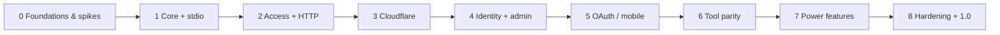

# Roadmap

> relic-bridge — an unofficial, open-source MCP server that gives AI agents access to New Relic through **NerdGraph**
> using only a User API key. Runs locally (stdio / Node / Docker) or as a **Cloudflare Worker** reachable from all your devices.

Status: **planning** (2026-10-01). Architecture: [ARCHITECTURE.md](ARCHITECTURE.md) · Decisions: [adr/](adr/) ·
Facts & limits: [RESEARCH.md](RESEARCH.md) · Security: [THREAT_MODEL.md](THREAT_MODEL.md) · Task rules: [tasks/README.md](tasks/README.md)

## Guiding principles

1. **Local-first, cloud-optional.** Every feature works without a Cloudflare account; the Worker is one deployment target.
2. **Runtime-agnostic core.** Web-standard APIs only in core packages; runtime code is limited to adapters.
3. **Read-only and least privilege by default.** Tool access is an intersection of project and grant; writes are opt-in.
4. **Security is a feature.** Threat model updated in the same PR as risky changes; secrets never leave the server.
5. **Built for agents.** Compact outputs, actionable errors, good tool descriptions, evals.
6. **Evidence before building.** Platform limits are measured in spikes (Phase 0) before features depend on them.

## Phases at a glance

| Phase | Theme | What you can do afterwards | Release |
|---|---|---|---|
| **0** | Foundations + risk spikes | Repo is public-ready; Workers/NerdGraph/OAuth risks measured | — |
| **1** | Core engine + stdio | `npx relic-bridge` locally, both NR accounts (one MCP entry per project) | v0.1 |
| **2** | Access model + self-hosted HTTP | Node/Docker server, per-project URLs, per-device tokens, audit log, admin API + CLI | v0.2 |
| **3** | Cloudflare Worker | Same server on Workers — **MacBook, PC and W365 connect via Claude Code** | v0.3 |
| **4** | Identity + admin panel | Google / GitHub / Cloudflare Access login, manage everything in the browser (phone-friendly) | v0.4 |
| **5** | OAuth 2.1 for MCP clients | **claude.ai web and Claude mobile** connect; per-device OAuth sessions | v0.5 |
| **6** | Tool parity | Alerts, issues, errors inbox, deployments, logs, APM, JVM, Kafka, synthetics, dashboards, reports, prompts, resources | v0.6 |
| **7** | Power features | Charts (MCP Apps), cache, deep links, doctor, import/export, Claude Code plugin, self-monitoring, opt-in write tools, DO limiter, keychain, quotas, Tasks | v0.7–0.9 |
| **8** | Hardening + launch | Final threat-model review, independent security review, benchmarks, docs site, support policy | **v1.0** |

> Parallelism: P0-10 (prior art) runs anytime; within Phase 1 the test harness (P1-12) starts with P1-01; Phase 6
> tools are largely independent of each other and can be split across agents.

## Decision log

| Date | Decision | Where |
|---|---|---|
| 2026-10-01 | Name `relic-bridge`, Apache-2.0 + DCO, Markdown tasks (no GitHub Issues for planning) | ADR-0001..0003 |
| 2026-10-01 | TS monorepo, Hono, SDK v2 stateless dual-era, SQLite/D1, AES-GCM, access model, auth sequencing | ADR-0004..0010 |
| 2026-10-01 | Phone requires OAuth → Phase 5; laptops served by bearer tokens from Phase 2/3 | RESEARCH §3 |
| 2026-10-01 | BYO-key recommended for teams (NerdGraph concurrency is per NR user) | RESEARCH §2, ADR-0008 |
| 2026-10-03 | Phase 0 spikes complete. **GO for Phase 1.** claude.ai / mobile client checks deferred to P5-06 | P0-11 |

## Task index

Generated from task front matter (`pnpm tasks index` once P0-05 lands). Status lives in each task file.

<!-- tasks:start -->
### Phase 0

| ID | Task | Priority | Depends on | Status |
|---|---|---|---|---|
| P0-01 | [Bootstrap the monorepo](tasks/phase-0-foundations/P0-01-repo-bootstrap.md) | high | — | done |
| P0-02 | [License and community files](tasks/phase-0-foundations/P0-02-license-community.md) | high | P0-01 | done |
| P0-03 | [CI pipeline](tasks/phase-0-foundations/P0-03-ci-pipeline.md) | high | P0-01 | done |
| P0-04 | [Security tooling baseline](tasks/phase-0-foundations/P0-04-security-tooling.md) | high | P0-03 | review |
| P0-05 | [AI-agent workflow and task tooling](tasks/phase-0-foundations/P0-05-agent-workflow.md) | high | P0-01 | done |
| P0-06 | [Spike: Workers free-plan CPU and subrequest budget](tasks/phase-0-foundations/P0-06-spike-workers-limits.md) | high | P0-01 | done |
| P0-07 | [Spike: MCP SDK v2 dual-era handler on Workers and Node with real clients](tasks/phase-0-foundations/P0-07-spike-mcp-sdk-v2.md) | high | P0-01 | done |
| P0-08 | [Spike: OAuth 2.1 server on Workers and Node, per-slug resources](tasks/phase-0-foundations/P0-08-spike-oauth-portability.md) | high | P0-07 | done |
| P0-09 | [Spike: NerdGraph behaviour, limits and fixtures](tasks/phase-0-foundations/P0-09-spike-nerdgraph-behaviour.md) | high | P0-01 | done |
| P0-10 | [Review community New Relic MCP servers](tasks/phase-0-foundations/P0-10-prior-art-review.md) | medium | — | done |
| P0-11 | [Spike results and go/no-go for Phase 1](tasks/phase-0-foundations/P0-11-spike-results-go-no-go.md) | high | P0-06, P0-07, P0-08, P0-09, P0-10 | done |

### Phase 1

| ID | Task | Priority | Depends on | Status |
|---|---|---|---|---|
| P1-01 | [Core package skeleton, tool registry and error model](tasks/phase-1-core-stdio/P1-01-core-skeleton.md) | high | P0-11 | done |
| P1-02 | [NerdGraph client (regions, retries, limiter, budget)](tasks/phase-1-core-stdio/P1-02-nerdgraph-client.md) | high | P1-01 | done |
| P1-03 | [NRQL execution engine (sync, async, cross-account)](tasks/phase-1-core-stdio/P1-03-nrql-engine.md) | high | P1-02 | done |
| P1-04 | [NRQL safety (escaping) and query limits](tasks/phase-1-core-stdio/P1-04-nrql-safety-limits.md) | high | P1-03 | done |
| P1-05 | [Output shaping v1 and untrusted-data envelope](tasks/phase-1-core-stdio/P1-05-output-shaping.md) | high | P1-03 | review |
| P1-06 | [Tools: run_nrql and get_query_result](tasks/phase-1-core-stdio/P1-06-tools-query.md) | high | P1-04, P1-05 | review |
| P1-07 | [Tools: whoami, list_accounts, time_range](tasks/phase-1-core-stdio/P1-07-tools-identity-accounts.md) | high | P1-02 | review |
| P1-08 | [Tools: search_entities, get_entity, get_related_entities, list_entity_types](tasks/phase-1-core-stdio/P1-08-tools-entities.md) | high | P1-04, P1-05 | review |
| P1-09 | [Tool: get_golden_metrics](tasks/phase-1-core-stdio/P1-09-tools-golden-metrics.md) | high | P1-06, P1-08 | review |
| P1-10 | [Tools: list_event_types, get_attributes](tasks/phase-1-core-stdio/P1-10-tools-schema-discovery.md) | high | P1-06 | review |
| P1-11 | [CLI with stdio mode (env and YAML config)](tasks/phase-1-core-stdio/P1-11-cli-stdio.md) | high | P1-06, P1-07 | review |
| P1-12 | [Test harness (fixtures, MCP contract tests, optional live suite)](tasks/phase-1-core-stdio/P1-12-test-harness.md) | high | P1-01 | review |
| P1-13 | [Generated tool reference docs](tasks/phase-1-core-stdio/P1-13-tool-reference-generator.md) | medium | P1-06 | review |
| P1-14 | [Docs — quickstart and client setup guides](tasks/phase-1-core-stdio/P1-14-docs-quickstart.md) | high | P1-11 | review |
| P1-15 | [Release pipeline and v0.1.0](tasks/phase-1-core-stdio/P1-15-release-v0-1.md) | high | P1-11, P1-12, P1-14 | review |
| P1-16 | [Isolate the OIDC publish step and make release reruns idempotent](tasks/phase-1-core-stdio/P1-16-release-publish-isolation.md) | high | P1-15 | review |
| P1-17 | [CLI warnings and docs accuracy follow-ups from the Phase 1 review](tasks/phase-1-core-stdio/P1-17-cli-docs-polish.md) | low | P1-11, P1-14 | todo |

### Phase 2

| ID | Task | Priority | Depends on | Status |
|---|---|---|---|---|
| P2-01 | [Storage interface, Drizzle schema and migrations](tasks/phase-2-access-http/P2-01-storage-interface-schema.md) | high | P1-15 | todo |
| P2-02 | [SQLite adapter for Node](tasks/phase-2-access-http/P2-02-sqlite-adapter.md) | high | P2-01 | todo |
| P2-03 | [Secrets encryption and master-key rotation](tasks/phase-2-access-http/P2-03-secrets-encryption.md) | high | P2-01 | todo |
| P2-04 | [Access model and effective-permission resolver](tasks/phase-2-access-http/P2-04-access-model.md) | high | P2-01, P2-03 | todo |
| P2-05 | [Access tokens (per device)](tasks/phase-2-access-http/P2-05-access-tokens.md) | high | P2-04 | todo |
| P2-06 | [HTTP app (Hono) with per-project MCP endpoints](tasks/phase-2-access-http/P2-06-http-app.md) | high | P2-05 | todo |
| P2-07 | [Rate limiting (pluggable)](tasks/phase-2-access-http/P2-07-rate-limiting.md) | high | P2-06 | todo |
| P2-08 | [Audit log](tasks/phase-2-access-http/P2-08-audit-log.md) | high | P2-06 | todo |
| P2-09 | [Admin REST API (API-first management)](tasks/phase-2-access-http/P2-09-admin-api.md) | high | P2-04, P2-05, P2-08 | todo |
| P2-10 | [CLI management commands (local and remote)](tasks/phase-2-access-http/P2-10-cli-management.md) | high | P2-09 | todo |
| P2-11 | [Docker image (signed, SBOM)](tasks/phase-2-access-http/P2-11-docker-image.md) | medium | P2-06, P2-02 | todo |
| P2-12 | [Authorization and isolation test suite](tasks/phase-2-access-http/P2-12-authz-isolation-tests.md) | high | P2-06, P2-09 | todo |
| P2-13 | [Docs — self-hosting, access model, multi-device setup](tasks/phase-2-access-http/P2-13-docs-self-hosting.md) | high | P2-10, P2-11 | todo |
| P2-14 | [Core tool consistency and envelope coverage clean-up](tasks/phase-2-access-http/P2-14-core-output-consistency.md) | low | — | todo |

### Phase 3

| ID | Task | Priority | Depends on | Status |
|---|---|---|---|---|
| P3-01 | [Cloudflare Worker entry and bindings](tasks/phase-3-cloudflare/P3-01-worker-entry.md) | high | P2-13 | todo |
| P3-02 | [D1 storage adapter](tasks/phase-3-cloudflare/P3-02-d1-adapter.md) | high | P3-01 | todo |
| P3-03 | [Workers plan presets (budget, CPU, connections)](tasks/phase-3-cloudflare/P3-03-workers-limits.md) | high | P3-01 | todo |
| P3-04 | [Rate limiting on Workers](tasks/phase-3-cloudflare/P3-04-workers-rate-limit.md) | medium | P3-01, P2-07 | todo |
| P3-05 | [Deploy to Cloudflare button and setup script](tasks/phase-3-cloudflare/P3-05-deploy-button-setup.md) | high | P3-02 | todo |
| P3-06 | [Workers integration tests in CI](tasks/phase-3-cloudflare/P3-06-workers-tests.md) | high | P3-02 | todo |
| P3-07 | [Docs — Cloudflare deployment, limits and costs](tasks/phase-3-cloudflare/P3-07-docs-cloudflare.md) | high | P3-05, P3-03 | todo |

### Phase 4

| ID | Task | Priority | Depends on | Status |
|---|---|---|---|---|
| P4-01 | [Identity providers: Google, GitHub, Cloudflare Access, generic OIDC](tasks/phase-4-identity-admin/P4-01-identity-providers.md) | high | P3-07 | todo |
| P4-02 | [Admin sessions, CSRF and roles](tasks/phase-4-identity-admin/P4-02-admin-sessions.md) | high | P4-01 | todo |
| P4-03 | [Admin UI scaffold (Hono JSX, strict CSP)](tasks/phase-4-identity-admin/P4-03-admin-ui-scaffold.md) | high | P4-02 | todo |
| P4-04 | [Admin screens: credentials, projects, grants, tokens, users](tasks/phase-4-identity-admin/P4-04-admin-screens.md) | high | P4-03 | todo |
| P4-05 | [Audit log viewer and usage stats](tasks/phase-4-identity-admin/P4-05-audit-viewer.md) | medium | P4-04, P2-08 | todo |
| P4-06 | [Connect page: client config snippets](tasks/phase-4-identity-admin/P4-06-connect-page.md) | high | P4-04 | todo |
| P4-07 | [Admin panel security review](tasks/phase-4-identity-admin/P4-07-admin-security-review.md) | high | P4-04 | todo |
| P4-08 | [Docs — admin guide and release v0.4](tasks/phase-4-identity-admin/P4-08-docs-admin.md) | medium | P4-05, P4-06, P4-07 | todo |

### Phase 5

| ID | Task | Priority | Depends on | Status |
|---|---|---|---|---|
| P5-01 | [OAuth 2.1 authorization server integration](tasks/phase-5-oauth/P5-01-oauth-server.md) | high | P4-08 | todo |
| P5-02 | [Per-slug Protected Resource Metadata and audience binding](tasks/phase-5-oauth/P5-02-protected-resource-metadata.md) | high | P5-01 | todo |
| P5-03 | [Client registration: CIMD and DCR](tasks/phase-5-oauth/P5-03-client-registration.md) | high | P5-02 | todo |
| P5-04 | [Login and consent screen](tasks/phase-5-oauth/P5-04-consent-screen.md) | high | P5-03 | todo |
| P5-05 | [Token lifecycle: expiry, refresh rotation, revocation](tasks/phase-5-oauth/P5-05-token-lifecycle.md) | high | P5-04 | todo |
| P5-06 | [Client compatibility matrix (incl. Claude mobile)](tasks/phase-5-oauth/P5-06-client-compat-matrix.md) | high | P5-05 | todo |
| P5-07 | [Docs — connecting from phone and claude.ai; release v0.5](tasks/phase-5-oauth/P5-07-docs-oauth.md) | high | P5-06 | todo |

### Phase 6

| ID | Task | Priority | Depends on | Status |
|---|---|---|---|---|
| P6-01 | [Tools: list_alert_policies, list_alert_conditions](tasks/phase-6-tool-parity/P6-01-tools-alerts.md) | high | P5-07 | todo |
| P6-02 | [Tools: list_recent_issues, search_incidents](tasks/phase-6-tool-parity/P6-02-tools-issues.md) | high | P5-07 | todo |
| P6-03 | [Tool: list_error_groups (Errors Inbox)](tasks/phase-6-tool-parity/P6-03-tools-errors-inbox.md) | high | P5-07 | todo |
| P6-04 | [Tools: list_change_events, analyze_deployment_impact](tasks/phase-6-tool-parity/P6-04-tools-change-tracking.md) | high | P5-07 | todo |
| P6-05 | [Tools: analyze_transactions, list_top_transactions](tasks/phase-6-tool-parity/P6-05-tools-apm.md) | high | P5-07 | todo |
| P6-06 | [Tools: list_recent_logs, analyze_entity_logs](tasks/phase-6-tool-parity/P6-06-tools-logs.md) | high | P5-07 | todo |
| P6-07 | [Tools: analyze_threads, list_gc_metrics, analyze_kafka_metrics](tasks/phase-6-tool-parity/P6-07-tools-runtime.md) | medium | P5-07 | todo |
| P6-08 | [Tool: list_synthetic_monitors (+ recent results)](tasks/phase-6-tool-parity/P6-08-tools-synthetics.md) | medium | P5-07 | todo |
| P6-09 | [Tools: list_dashboards, get_dashboard](tasks/phase-6-tool-parity/P6-09-tools-dashboards.md) | medium | P5-07 | todo |
| P6-10 | [Composite reports: alert insights and user impact](tasks/phase-6-tool-parity/P6-10-composite-reports.md) | medium | P6-02, P6-04, P6-06 | todo |
| P6-11 | [MCP prompts: investigation workflows](tasks/phase-6-tool-parity/P6-11-mcp-prompts.md) | medium | P6-10 | todo |
| P6-12 | [MCP resources: NRQL reference and schema snapshots](tasks/phase-6-tool-parity/P6-12-mcp-resources.md) | medium | P5-07 | todo |
| P6-13 | [Tool description quality and agent evals](tasks/phase-6-tool-parity/P6-13-tool-evals.md) | medium | P6-10 | todo |
| P6-14 | [Fuzzy entity-name resolution with per-credential cache](tasks/phase-6-tool-parity/P6-14-fuzzy-entity-resolution.md) | medium | P5-07 | todo |
| P6-15 | [Decide on a raw NerdGraph tool (ADR)](tasks/phase-6-tool-parity/P6-15-raw-nerdgraph-decision.md) | low | P5-07 | todo |
| P6-16 | [Investigation workflow tools (error trace, dependency health)](tasks/phase-6-tool-parity/P6-16-investigation-workflow-tools.md) | medium | P6-05, P6-06, P6-03 | todo |

### Phase 7

| ID | Task | Priority | Depends on | Status |
|---|---|---|---|---|
| P7-01 | [Result shaping v2: summaries, downsampling, stats](tasks/phase-7-power-features/P7-01-result-shaping-v2.md) | medium | P6-13 | todo |
| P7-02 | [Query cache (Cache API / in-memory LRU)](tasks/phase-7-power-features/P7-02-query-cache.md) | medium | P6-13 | todo |
| P7-03 | [Deep links to the New Relic UI](tasks/phase-7-power-features/P7-03-deep-links.md) | low | P6-13 | todo |
| P7-04 | [Interactive charts via MCP Apps extension](tasks/phase-7-power-features/P7-04-mcp-apps-charts.md) | medium | P6-13 | todo |
| P7-05 | [relic-bridge doctor](tasks/phase-7-power-features/P7-05-doctor.md) | medium | P6-13 | todo |
| P7-06 | [Config import/export](tasks/phase-7-power-features/P7-06-import-export.md) | low | P6-13 | todo |
| P7-07 | [Claude Code plugin (MCP config + skills + commands)](tasks/phase-7-power-features/P7-07-claude-code-plugin.md) | medium | P6-13 | todo |
| P7-08 | [Self-monitoring via OpenTelemetry (opt-in)](tasks/phase-7-power-features/P7-08-self-monitoring.md) | low | P6-13 | todo |
| P7-09 | [Opt-in write tools](tasks/phase-7-power-features/P7-09-write-tools.md) | medium | P6-13 | todo |
| P7-10 | [Durable Object concurrency limiter for shared keys](tasks/phase-7-power-features/P7-10-do-concurrency-limiter.md) | low | P6-13 | todo |
| P7-11 | [OS keychain for local credentials](tasks/phase-7-power-features/P7-11-os-keychain.md) | low | P6-13 | todo |
| P7-12 | [Per-grant quotas and usage dashboard](tasks/phase-7-power-features/P7-12-quotas-usage.md) | low | P6-13 | todo |
| P7-13 | [Async tool runs via MCP Tasks extension](tasks/phase-7-power-features/P7-13-tasks-extension.md) | low | P6-13 | todo |
| P7-14 | [Registry-friendly tool discovery (lazy auth)](tasks/phase-7-power-features/P7-14-lazy-auth-discovery.md) | low | P6-13 | todo |

### Phase 8

| ID | Task | Priority | Depends on | Status |
|---|---|---|---|---|
| P8-01 | [Threat model final review and fuzzing](tasks/phase-8-hardening-launch/P8-01-threat-model-final.md) | high | P7-04, P7-09 | todo |
| P8-02 | [Independent security review](tasks/phase-8-hardening-launch/P8-02-external-review.md) | high | P8-01 | todo |
| P8-03 | [Performance and cost benchmarks](tasks/phase-8-hardening-launch/P8-03-performance-cost.md) | medium | P7-04, P7-09 | todo |
| P8-04 | [Documentation site](tasks/phase-8-hardening-launch/P8-04-docs-site.md) | high | P7-04, P7-09 | todo |
| P8-05 | [Versioning, support and deprecation policy](tasks/phase-8-hardening-launch/P8-05-support-policy.md) | medium | P7-04, P7-09 | todo |
| P8-06 | [1.0 launch](tasks/phase-8-hardening-launch/P8-06-launch.md) | high | P8-02, P8-03, P8-04, P8-05 | todo |
| P8-07 | [CI supply-chain hardening follow-ups](tasks/phase-8-hardening-launch/P8-07-ci-supply-chain-hardening.md) | medium | P1-16 | todo |
<!-- tasks:end -->
