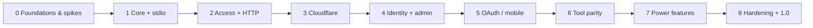

# Roadmap

> relic-bridge — an unofficial, open-source MCP server that gives AI agents access to New Relic through **NerdGraph**
> using only a User API key. Runs locally (stdio / Node / Docker) or as a **Cloudflare Worker** reachable from all your devices.

Status: **Phases 0-7 merged on `main`** (#170-#177), **Phase 8 in progress** toward 1.0; releases are listed in the [CHANGELOG](../apps/cli/CHANGELOG.md) (npm with provenance, GitHub Release, signed GHCR image). Architecture: [ARCHITECTURE.md](ARCHITECTURE.md) · Decisions: [adr/](adr/) ·
Facts & limits: [RESEARCH.md](RESEARCH.md) · Security: [THREAT_MODEL.md](THREAT_MODEL.md) · Task rules: [tasks/README.md](tasks/README.md)

## Guiding principles

1. **Local-first, cloud-optional.** Every feature works without a Cloudflare account; the Worker is one deployment target.
2. **Runtime-agnostic core.** Web-standard APIs only in core packages; runtime code is limited to adapters.
3. **Read-only and least privilege by default.** Tool access is an intersection of project and grant; writes are opt-in.
4. **Security is a feature.** Threat model updated in the same PR as risky changes; secrets never leave the server.
5. **Built for agents.** Compact outputs, actionable errors, good tool descriptions, evals.
6. **Evidence before building.** Platform limits are measured in spikes (Phase 0) before features depend on them.

## Phases at a glance

| Phase | Theme | What you can do afterwards | Release |
|---|---|---|---|
| **0** | Foundations + risk spikes | Repo is public-ready; Workers/NerdGraph/OAuth risks measured | — |
| **1** | Core engine + stdio | `npx relic-bridge` locally, both NR accounts (one MCP entry per project) | v0.1 |
| **2** | Access model + self-hosted HTTP | Node/Docker server, per-project URLs, per-device tokens, audit log, admin API + CLI | v0.2 |
| **3** | Cloudflare Worker | Same server on Workers — **MacBook, PC and W365 connect via Claude Code** | v0.3 |
| **4** | Identity + admin panel | Google / GitHub / Cloudflare Access login, manage everything in the browser (phone-friendly) | v0.4 |
| **5** | OAuth 2.1 for MCP clients | **claude.ai web and Claude mobile** connect; per-device OAuth sessions | v0.5 |
| **6** | Tool parity | Alerts, issues, errors inbox, deployments, logs, APM, JVM, Kafka, synthetics, dashboards, reports, prompts, resources | v0.6 |
| **7** | Power features | Charts (MCP Apps), cache, deep links, doctor, import/export, Claude Code plugin, self-monitoring, opt-in write tools, DO limiter, keychain, quotas, Tasks | v0.7–0.9 |
| **8** | Hardening + launch | Final threat-model review, independent security review, benchmarks, docs site, support policy | **v1.0** |

> Release numbers per phase are the original plan. Nothing was published along the way: phases 1-7 shipped together as
> the first release, **0.7.0**; 0.8.0 carries the live-test fixes; v1.0 follows Phase 8.

> Parallelism: P0-10 (prior art) runs anytime; within Phase 1 the test harness (P1-12) starts with P1-01; Phase 6
> tools are largely independent of each other and can be split across agents.

## Decision log

| Date | Decision | Where |
|---|---|---|
| 2026-10-01 | Name `relic-bridge`, Apache-2.0 + DCO, Markdown tasks (no GitHub Issues for planning) | ADR-0001..0003 |
| 2026-10-01 | TS monorepo, Hono, SDK v2 stateless dual-era, SQLite/D1, AES-GCM, access model, auth sequencing | ADR-0004..0010 |
| 2026-10-01 | Phone requires OAuth → Phase 5; laptops served by bearer tokens from Phase 2/3 | RESEARCH §3 |
| 2026-10-01 | BYO-key recommended for teams (NerdGraph concurrency is per NR user) | RESEARCH §2, ADR-0008 |
| 2026-10-03 | Phase 0 spikes complete. **GO for Phase 1.** claude.ai / mobile client checks deferred to P5-06 | P0-11 |
| 2026-10-03 | Phase 1 (core + stdio) and Phase 2 (access model + HTTP) built; open owner questions in `pending-decisions/` | [reviews](reviews/) |
| 2026-10-09 | Owner reviewed all pending decisions (ADR-0016); repository moved to `mhidalgo-lab/relic-bridge`; Linux CI runs on the organization's self-hosted runners | [pending-decisions](pending-decisions/), ADR-0016, P8-08, P8-13 |
| 2026-10-10 | Phases landed on `main` one at a time via squash merges (#170-#177); nothing was released in between, so the first release is numbered **0.7.0** (v1.0 after Phase 8) | P8-13, P8-14 |

## Task index

Generated from task front matter (`pnpm tasks index`). Status lives in each task file.

<!-- tasks:start -->
### Phase 0

| ID | Task | Priority | Depends on | Status |
|---|---|---|---|---|
| P0-01 | [Bootstrap the monorepo](tasks/phase-0-foundations/P0-01-repo-bootstrap.md) | high | — | done |
| P0-02 | [License and community files](tasks/phase-0-foundations/P0-02-license-community.md) | high | P0-01 | done |
| P0-03 | [CI pipeline](tasks/phase-0-foundations/P0-03-ci-pipeline.md) | high | P0-01 | done |
| P0-04 | [Security tooling baseline](tasks/phase-0-foundations/P0-04-security-tooling.md) | high | P0-03 | done |
| P0-05 | [AI-agent workflow and task tooling](tasks/phase-0-foundations/P0-05-agent-workflow.md) | high | P0-01 | done |
| P0-06 | [Spike: Workers free-plan CPU and subrequest budget](tasks/phase-0-foundations/P0-06-spike-workers-limits.md) | high | P0-01 | done |
| P0-07 | [Spike: MCP SDK v2 dual-era handler on Workers and Node with real clients](tasks/phase-0-foundations/P0-07-spike-mcp-sdk-v2.md) | high | P0-01 | done |
| P0-08 | [Spike: OAuth 2.1 server on Workers and Node, per-slug resources](tasks/phase-0-foundations/P0-08-spike-oauth-portability.md) | high | P0-07 | done |
| P0-09 | [Spike: NerdGraph behaviour, limits and fixtures](tasks/phase-0-foundations/P0-09-spike-nerdgraph-behaviour.md) | high | P0-01 | done |
| P0-10 | [Review community New Relic MCP servers](tasks/phase-0-foundations/P0-10-prior-art-review.md) | medium | — | done |
| P0-11 | [Spike results and go/no-go for Phase 1](tasks/phase-0-foundations/P0-11-spike-results-go-no-go.md) | high | P0-06, P0-07, P0-08, P0-09, P0-10 | done |

### Phase 1

| ID | Task | Priority | Depends on | Status |
|---|---|---|---|---|
| P1-01 | [Core package skeleton, tool registry and error model](tasks/phase-1-core-stdio/P1-01-core-skeleton.md) | high | P0-11 | done |
| P1-02 | [NerdGraph client (regions, retries, limiter, budget)](tasks/phase-1-core-stdio/P1-02-nerdgraph-client.md) | high | P1-01 | done |
| P1-03 | [NRQL execution engine (sync, async, cross-account)](tasks/phase-1-core-stdio/P1-03-nrql-engine.md) | high | P1-02 | done |
| P1-04 | [NRQL safety (escaping) and query limits](tasks/phase-1-core-stdio/P1-04-nrql-safety-limits.md) | high | P1-03 | done |
| P1-05 | [Output shaping v1 and untrusted-data envelope](tasks/phase-1-core-stdio/P1-05-output-shaping.md) | high | P1-03 | done |
| P1-06 | [Tools: run_nrql and get_query_result](tasks/phase-1-core-stdio/P1-06-tools-query.md) | high | P1-04, P1-05 | done |
| P1-07 | [Tools: whoami, list_accounts, time_range](tasks/phase-1-core-stdio/P1-07-tools-identity-accounts.md) | high | P1-02 | done |
| P1-08 | [Tools: search_entities, get_entity, get_related_entities, list_entity_types](tasks/phase-1-core-stdio/P1-08-tools-entities.md) | high | P1-04, P1-05 | done |
| P1-09 | [Tool: get_golden_metrics](tasks/phase-1-core-stdio/P1-09-tools-golden-metrics.md) | high | P1-06, P1-08 | done |
| P1-10 | [Tools: list_event_types, get_attributes](tasks/phase-1-core-stdio/P1-10-tools-schema-discovery.md) | high | P1-06 | done |
| P1-11 | [CLI with stdio mode (env and YAML config)](tasks/phase-1-core-stdio/P1-11-cli-stdio.md) | high | P1-06, P1-07 | done |
| P1-12 | [Test harness (fixtures, MCP contract tests, optional live suite)](tasks/phase-1-core-stdio/P1-12-test-harness.md) | high | P1-01 | done |
| P1-13 | [Generated tool reference docs](tasks/phase-1-core-stdio/P1-13-tool-reference-generator.md) | medium | P1-06 | done |
| P1-14 | [Docs — quickstart and client setup guides](tasks/phase-1-core-stdio/P1-14-docs-quickstart.md) | high | P1-11 | done |
| P1-15 | [Release pipeline and v0.1.0](tasks/phase-1-core-stdio/P1-15-release-v0-1.md) | high | P1-11, P1-12, P1-14 | done |
| P1-16 | [Isolate the OIDC publish step and make release reruns idempotent](tasks/phase-1-core-stdio/P1-16-release-publish-isolation.md) | high | P1-15 | done |
| P1-17 | [CLI warnings and docs accuracy follow-ups from the Phase 1 review](tasks/phase-1-core-stdio/P1-17-cli-docs-polish.md) | low | P1-11, P1-14 | done |
| P1-18 | [Require npm staged-publish approval on top of the release environment](tasks/phase-1-core-stdio/P1-18-npm-staged-publish.md) | high | P1-16 | done |

### Phase 2

| ID | Task | Priority | Depends on | Status |
|---|---|---|---|---|
| P2-01 | [Storage interface, Drizzle schema and migrations](tasks/phase-2-access-http/P2-01-storage-interface-schema.md) | high | P1-15 | done |
| P2-02 | [SQLite adapter for Node](tasks/phase-2-access-http/P2-02-sqlite-adapter.md) | high | P2-01 | done |
| P2-03 | [Secrets encryption and master-key rotation](tasks/phase-2-access-http/P2-03-secrets-encryption.md) | high | P2-01 | done |
| P2-04 | [Access model and effective-permission resolver](tasks/phase-2-access-http/P2-04-access-model.md) | high | P2-01, P2-03 | done |
| P2-05 | [Access tokens (per device)](tasks/phase-2-access-http/P2-05-access-tokens.md) | high | P2-04 | done |
| P2-06 | [HTTP app (Hono) with per-project MCP endpoints](tasks/phase-2-access-http/P2-06-http-app.md) | high | P2-05 | done |
| P2-07 | [Rate limiting (pluggable)](tasks/phase-2-access-http/P2-07-rate-limiting.md) | high | P2-06 | done |
| P2-08 | [Audit log](tasks/phase-2-access-http/P2-08-audit-log.md) | high | P2-06 | done |
| P2-09 | [Admin REST API (API-first management)](tasks/phase-2-access-http/P2-09-admin-api.md) | high | P2-04, P2-05, P2-08 | done |
| P2-10 | [CLI management commands (local and remote)](tasks/phase-2-access-http/P2-10-cli-management.md) | high | P2-09 | done |
| P2-11 | [Docker image (signed, SBOM)](tasks/phase-2-access-http/P2-11-docker-image.md) | medium | P2-06, P2-02 | done |
| P2-12 | [Authorization and isolation test suite](tasks/phase-2-access-http/P2-12-authz-isolation-tests.md) | high | P2-06, P2-09 | done |
| P2-13 | [Docs — self-hosting, access model, multi-device setup](tasks/phase-2-access-http/P2-13-docs-self-hosting.md) | high | P2-10, P2-11 | done |
| P2-14 | [Core tool consistency and envelope coverage clean-up](tasks/phase-2-access-http/P2-14-core-output-consistency.md) | low | — | done |
| P2-15 | [Pass-through mode (client-supplied New Relic key)](tasks/phase-2-access-http/P2-15-passthrough-mode.md) | low | P2-06, P2-07 | done |
| P2-16 | [Audit tool calls on the pass-through route](tasks/phase-2-access-http/P2-16-passthrough-audit.md) | low | P2-08, P2-15 | done |
| P2-17 | [Admin API audit and error-model follow-ups](tasks/phase-2-access-http/P2-17-admin-audit-followups.md) | medium | P2-09 | done |
| P2-18 | [Phase 2 docs accuracy sweep](tasks/phase-2-access-http/P2-18-docs-accuracy-sweep.md) | medium | P2-13 | done |
| P2-19 | [Docker release hardening and an end-to-end image smoke test](tasks/phase-2-access-http/P2-19-docker-release-hardening.md) | medium | P2-11 | done |

### Phase 3

| ID | Task | Priority | Depends on | Status |
|---|---|---|---|---|
| P3-01 | [Cloudflare Worker entry and bindings](tasks/phase-3-cloudflare/P3-01-worker-entry.md) | high | P2-13 | done |
| P3-02 | [D1 storage adapter](tasks/phase-3-cloudflare/P3-02-d1-adapter.md) | high | P3-01 | done |
| P3-03 | [Workers plan presets (budget, CPU, connections)](tasks/phase-3-cloudflare/P3-03-workers-limits.md) | high | P3-01 | done |
| P3-04 | [Rate limiting on Workers](tasks/phase-3-cloudflare/P3-04-workers-rate-limit.md) | medium | P3-01, P2-07 | done |
| P3-05 | [Deploy to Cloudflare button and setup script](tasks/phase-3-cloudflare/P3-05-deploy-button-setup.md) | high | P3-02 | done |
| P3-06 | [Workers integration tests in CI](tasks/phase-3-cloudflare/P3-06-workers-tests.md) | high | P3-02 | done |
| P3-07 | [Docs — Cloudflare deployment, limits and costs](tasks/phase-3-cloudflare/P3-07-docs-cloudflare.md) | high | P3-05, P3-03 | done |
| P3-08 | [Audit retention purge on Workers (cron trigger)](tasks/phase-3-cloudflare/P3-08-workers-audit-purge.md) | medium | P3-02 | done |
| P3-09 | [Resolve access in one D1 round trip](tasks/phase-3-cloudflare/P3-09-d1-single-query-access.md) | medium | P3-02 | done |
| P3-10 | [CPU benchmark per tool to catch regressions](tasks/phase-3-cloudflare/P3-10-cpu-benchmark.md) | low | P3-03 | done |
| P3-11 | [Master-key rotation for a D1 database](tasks/phase-3-cloudflare/P3-11-d1-master-key-rotation.md) | medium | P3-02, P3-05 | done |
| P3-12 | [Single-flight Worker boot with failure backoff](tasks/phase-3-cloudflare/P3-12-worker-boot-single-flight.md) | medium | P3-01 | done |
| P3-13 | [Admin token strength check and auth-failure throttle that cannot lock out valid tokens](tasks/phase-3-cloudflare/P3-13-admin-token-strength-failure-throttle.md) | medium | P3-04 | done |
| P3-14 | [cf:setup follow-ups (config refresh, rate-limit namespace, Windows docs, README button)](tasks/phase-3-cloudflare/P3-14-cf-setup-followups.md) | low | P3-05 | done |
| P3-15 | [Key-rotation guards (unreadable rows warning, Free-plan batch size, kv TTL validation)](tasks/phase-3-cloudflare/P3-15-rotation-guards.md) | low | P3-11 | done |

### Phase 4

| ID | Task | Priority | Depends on | Status |
|---|---|---|---|---|
| P4-01 | [Identity providers: Google, GitHub, Cloudflare Access, generic OIDC](tasks/phase-4-identity-admin/P4-01-identity-providers.md) | high | P3-07 | done |
| P4-02 | [Admin sessions, CSRF and roles](tasks/phase-4-identity-admin/P4-02-admin-sessions.md) | high | P4-01 | done |
| P4-03 | [Admin UI scaffold (Hono JSX, strict CSP)](tasks/phase-4-identity-admin/P4-03-admin-ui-scaffold.md) | high | P4-02 | done |
| P4-04 | [Admin screens: credentials, projects, grants, tokens, users](tasks/phase-4-identity-admin/P4-04-admin-screens.md) | high | P4-03 | done |
| P4-05 | [Audit log viewer and usage stats](tasks/phase-4-identity-admin/P4-05-audit-viewer.md) | medium | P4-04, P2-08 | done |
| P4-06 | [Connect page: client config snippets](tasks/phase-4-identity-admin/P4-06-connect-page.md) | high | P4-04 | done |
| P4-07 | [Admin panel security review](tasks/phase-4-identity-admin/P4-07-admin-security-review.md) | high | P4-04 | done |
| P4-08 | [Docs — admin guide and release v0.4](tasks/phase-4-identity-admin/P4-08-docs-admin.md) | medium | P4-05, P4-06, P4-07 | done |
| P4-09 | [Sign-in operations: identity re-binding, setup-link CLI, Worker setup for IdP secrets](tasks/phase-4-identity-admin/P4-09-sign-in-operations.md) | medium | P4-01 | done |
| P4-10 | [Member self-service API: own credentials, grants and device tokens](tasks/phase-4-identity-admin/P4-10-member-self-service.md) | medium | P4-02 | done |
| P4-11 | [Admin panel in a real browser: Playwright E2E and guide screenshots](tasks/phase-4-identity-admin/P4-11-admin-browser-e2e.md) | medium | P4-04 | done |
| P4-12 | [ZAP baseline scan of the admin panel](tasks/phase-4-identity-admin/P4-12-zap-baseline-scan.md) | low | P4-07 | done |
| P4-13 | [Revoke the GitHub OAuth token after the identity lookup](tasks/phase-4-identity-admin/P4-13-github-token-revoke.md) | low | P4-01 | done |
| P4-14 | [Move a user to another provider from the admin panel](tasks/phase-4-identity-admin/P4-14-unbind-in-admin-ui.md) | low | P4-09, P4-04 | done |
| P4-15 | [Member self-service screens in the admin panel](tasks/phase-4-identity-admin/P4-15-member-self-service-screens.md) | medium | P4-10, P4-04 | done |
| P4-16 | [Bind identities atomically and keep at least one owner](tasks/phase-4-identity-admin/P4-16-atomic-binding-last-owner.md) | medium | P4-01, P4-09 | done |
| P4-17 | [Cap live sessions per user and revoke them in bounded batches](tasks/phase-4-identity-admin/P4-17-session-cap-batched-revoke.md) | medium | P4-02 | done |
| P4-18 | [Tighten member key switching and personal keys as project defaults](tasks/phase-4-identity-admin/P4-18-member-key-switch-rules.md) | low | P4-10 | done |
| P4-19 | [Bound the storage writes signed-in users can cause](tasks/phase-4-identity-admin/P4-19-bound-self-service-writes.md) | low | P4-07, P4-10 | done |
| P4-20 | [Phase 4 test, docs and UI hygiene from the consolidation review](tasks/phase-4-identity-admin/P4-20-phase-4-hygiene.md) | low | P4-08 | done |
| P4-21 | [Only owners create, demote, disable or unbind administrators](tasks/phase-4-identity-admin/P4-21-owner-only-admin-management.md) | medium | P4-16 | done |
| P4-22 | [Warn at startup when an allowlist is set but auto-provisioning is off](tasks/phase-4-identity-admin/P4-22-allowlist-without-autoprovision-warning.md) | low | P4-08 | done |
| P4-23 | [Limit fields on the admin panel grant form](tasks/phase-4-identity-admin/P4-23-grant-form-limits.md) | low | P4-04 | done |
| P4-24 | [Weekly schedule for the ZAP scan and browser E2E workflows](tasks/phase-4-identity-admin/P4-24-scheduled-zap-e2e.md) | low | P4-11, P4-12 | done |

### Phase 5

| ID | Task | Priority | Depends on | Status |
|---|---|---|---|---|
| P5-01 | [OAuth 2.1 authorization server integration](tasks/phase-5-oauth/P5-01-oauth-server.md) | high | P4-08 | done |
| P5-02 | [Per-slug Protected Resource Metadata and audience binding](tasks/phase-5-oauth/P5-02-protected-resource-metadata.md) | high | P5-01 | done |
| P5-03 | [Client registration: CIMD and DCR](tasks/phase-5-oauth/P5-03-client-registration.md) | high | P5-02 | done |
| P5-04 | [Login and consent screen](tasks/phase-5-oauth/P5-04-consent-screen.md) | high | P5-03 | done |
| P5-05 | [Token lifecycle: expiry, refresh rotation, revocation](tasks/phase-5-oauth/P5-05-token-lifecycle.md) | high | P5-04 | done |
| P5-06 | [Client compatibility matrix (incl. Claude mobile)](tasks/phase-5-oauth/P5-06-client-compat-matrix.md) | high | P5-05 | done |
| P5-07 | [Docs — connecting from phone and claude.ai; release v0.5](tasks/phase-5-oauth/P5-07-docs-oauth.md) | high | P5-06 | done |
| P5-08 | [Admin: OAuth client list, revoke and DCR switch](tasks/phase-5-oauth/P5-08-admin-oauth-clients.md) | medium | P5-03 | done |
| P5-09 | [Decide and handle concurrent refreshes from real clients](tasks/phase-5-oauth/P5-09-refresh-concurrency.md) | medium | P5-06 | done |
| P5-10 | [Bound what anonymous callers can do to registration and CIMD](tasks/phase-5-oauth/P5-10-oauth-unauthenticated-abuse.md) | medium | P5-03, P5-08 | done |
| P5-11 | [Device replacement policy and complete per-user device bounds](tasks/phase-5-oauth/P5-11-oauth-device-bounds.md) | medium | P5-05, P5-08 | done |
| P5-12 | [OAuth protocol nits from the Phase 5 review](tasks/phase-5-oauth/P5-12-oauth-spec-nits.md) | low | P5-04 | done |
| P5-13 | [Remove the unused OAUTH_KV Worker binding](tasks/phase-5-oauth/P5-13-remove-oauth-kv-binding.md) | low | P5-01 | done |

### Phase 6

| ID | Task | Priority | Depends on | Status |
|---|---|---|---|---|
| P6-01 | [Tools: list_alert_policies, list_alert_conditions](tasks/phase-6-tool-parity/P6-01-tools-alerts.md) | high | P5-07 | done |
| P6-02 | [Tools: list_recent_issues, search_incidents](tasks/phase-6-tool-parity/P6-02-tools-issues.md) | high | P5-07 | done |
| P6-03 | [Tool: list_error_groups (Errors Inbox)](tasks/phase-6-tool-parity/P6-03-tools-errors-inbox.md) | high | P5-07 | done |
| P6-04 | [Tools: list_change_events, analyze_deployment_impact](tasks/phase-6-tool-parity/P6-04-tools-change-tracking.md) | high | P5-07 | done |
| P6-05 | [Tools: analyze_transactions, list_top_transactions](tasks/phase-6-tool-parity/P6-05-tools-apm.md) | high | P5-07 | done |
| P6-06 | [Tools: list_recent_logs, analyze_entity_logs](tasks/phase-6-tool-parity/P6-06-tools-logs.md) | high | P5-07 | done |
| P6-07 | [Tools: analyze_threads, list_gc_metrics, analyze_kafka_metrics](tasks/phase-6-tool-parity/P6-07-tools-runtime.md) | medium | P5-07 | done |
| P6-08 | [Tool: list_synthetic_monitors (+ recent results)](tasks/phase-6-tool-parity/P6-08-tools-synthetics.md) | medium | P5-07 | done |
| P6-09 | [Tools: list_dashboards, get_dashboard](tasks/phase-6-tool-parity/P6-09-tools-dashboards.md) | medium | P5-07 | done |
| P6-10 | [Composite reports: alert insights and user impact](tasks/phase-6-tool-parity/P6-10-composite-reports.md) | medium | P6-02, P6-04, P6-06 | done |
| P6-11 | [MCP prompts: investigation workflows](tasks/phase-6-tool-parity/P6-11-mcp-prompts.md) | medium | P6-10 | done |
| P6-12 | [MCP resources: NRQL reference and schema snapshots](tasks/phase-6-tool-parity/P6-12-mcp-resources.md) | medium | P6-11 | done |
| P6-13 | [Tool description quality and agent evals](tasks/phase-6-tool-parity/P6-13-tool-evals.md) | medium | P6-10 | done |
| P6-14 | [Fuzzy entity-name resolution with per-credential cache](tasks/phase-6-tool-parity/P6-14-fuzzy-entity-resolution.md) | medium | P5-07 | done |
| P6-15 | [Decide on a raw NerdGraph tool (ADR)](tasks/phase-6-tool-parity/P6-15-raw-nerdgraph-decision.md) | low | P5-07 | done |
| P6-16 | [Investigation workflow tools (error trace, dependency health)](tasks/phase-6-tool-parity/P6-16-investigation-workflow-tools.md) | medium | P6-05, P6-06, P6-03 | done |
| P6-17 | [Accept an entity name in guid-taking tools via the shared resolver](tasks/phase-6-tool-parity/P6-17-name-input-on-entity-tools.md) | low | P6-14 | done |
| P6-18 | [Accept an entity name in the report, investigation and signal tools](tasks/phase-6-tool-parity/P6-18-name-input-on-report-and-signal-tools.md) | low | P6-17 | done |
| P6-19 | [Trim tool input schema text (tools/list size)](tasks/phase-6-tool-parity/P6-19-trim-input-schema-text.md) | low | P6-13 | done |
| P6-20 | [Honest tool costs and budget planning (polls, retries, resolution)](tasks/phase-6-tool-parity/P6-20-tool-cost-accounting.md) | medium | P6-18 | done |
| P6-21 | [Untrusted-text and scope hardening follow-ups from the Phase 6 review](tasks/phase-6-tool-parity/P6-21-untrusted-text-hardening.md) | medium | P6-19 | done |
| P6-22 | [Consistent tool argument and output naming before 1.0](tasks/phase-6-tool-parity/P6-22-tool-argument-consistency.md) | medium | P6-19 | done |
| P6-23 | [Phase 6 review nits: lint gaps, test gaps, small correctness issues](tasks/phase-6-tool-parity/P6-23-phase-6-review-nits.md) | low | P6-19 | done |
| P6-24 | [Paging and limit parity across list tools](tasks/phase-6-tool-parity/P6-24-paging-and-limit-parity.md) | low | P6-22 | done |
| P6-25 | [Warn in the grant editor when a composite tool lacks its sibling tools](tasks/phase-6-tool-parity/P6-25-composite-grant-warning.md) | low | P6-21, P4-23 | done |

### Phase 7

| ID | Task | Priority | Depends on | Status |
|---|---|---|---|---|
| P7-01 | [Result shaping v2: summaries, downsampling, stats](tasks/phase-7-power-features/P7-01-result-shaping-v2.md) | medium | P6-13 | done |
| P7-02 | [Query cache (Cache API / in-memory LRU)](tasks/phase-7-power-features/P7-02-query-cache.md) | medium | P6-13 | done |
| P7-03 | [Deep links to the New Relic UI](tasks/phase-7-power-features/P7-03-deep-links.md) | low | P6-13 | done |
| P7-04 | [Interactive charts via MCP Apps extension](tasks/phase-7-power-features/P7-04-mcp-apps-charts.md) | medium | P6-13 | done |
| P7-05 | [relic-bridge doctor](tasks/phase-7-power-features/P7-05-doctor.md) | medium | P6-13 | done |
| P7-06 | [Config import/export](tasks/phase-7-power-features/P7-06-import-export.md) | low | P6-13 | done |
| P7-07 | [Claude Code plugin (MCP config + skills + commands)](tasks/phase-7-power-features/P7-07-claude-code-plugin.md) | medium | P6-13 | done |
| P7-08 | [Self-monitoring via OpenTelemetry (opt-in)](tasks/phase-7-power-features/P7-08-self-monitoring.md) | low | P6-13 | done |
| P7-09 | [Opt-in write tools](tasks/phase-7-power-features/P7-09-write-tools.md) | medium | P6-13 | done |
| P7-10 | [Durable Object concurrency limiter for shared keys](tasks/phase-7-power-features/P7-10-do-concurrency-limiter.md) | low | P6-13 | done |
| P7-11 | [OS keychain for local credentials](tasks/phase-7-power-features/P7-11-os-keychain.md) | low | P6-13 | done |
| P7-12 | [Per-grant quotas and usage dashboard](tasks/phase-7-power-features/P7-12-quotas-usage.md) | low | P6-13 | done |
| P7-13 | [Async tool runs via MCP Tasks extension](tasks/phase-7-power-features/P7-13-tasks-extension.md) | low | P6-13 | done |
| P7-14 | [Registry-friendly tool discovery (lazy auth)](tasks/phase-7-power-features/P7-14-lazy-auth-discovery.md) | low | P6-13 | done |
| P7-15 | [Opt-in, validated read-only NerdGraph query tool (only if ADR-0014 is reversed)](tasks/phase-7-power-features/P7-15-opt-in-nerdgraph-query.md) | low | P6-15 | blocked |
| P7-16 | [MCP Apps: capability-gated UI metadata and an operator switch](tasks/phase-7-power-features/P7-16-mcp-apps-gating.md) | low | P7-04 | done |
| P7-17 | [doctor: client config files and remote token validity](tasks/phase-7-power-features/P7-17-doctor-client-configs.md) | low | P7-05 | done |
| P7-18 | [OTLP follow-ups: logs, budget usage, stdio, trace context](tasks/phase-7-power-features/P7-18-otel-logs-budget-stdio.md) | low | P7-08 | done |
| P7-19 | [create_dashboard write tool](tasks/phase-7-power-features/P7-19-create-dashboard-write-tool.md) | low | P7-09 | done |
| P7-20 | [Confirm write tool calls through MCP elicitation](tasks/phase-7-power-features/P7-20-write-confirm-elicitation.md) | low | P7-09 | done |
| P7-21 | [MCP Tasks for composite reports and multi-query tools](tasks/phase-7-power-features/P7-21-tasks-composite-reports.md) | low | P7-13 | done |
| P7-22 | [MCP Tasks: status notifications, stdio and pass-through](tasks/phase-7-power-features/P7-22-tasks-notifications-stdio.md) | low | P7-13 | done |
| P7-23 | [MCP Tasks for the other composite reports and multi-query tools](tasks/phase-7-power-features/P7-23-tasks-other-composites.md) | low | P7-21 | done |
| P7-24 | [Write rate limit enforced deployment-wide on Workers](tasks/phase-7-power-features/P7-24-write-rate-limit-deployment-wide.md) | medium | P7-10 | done |
| P7-25 | [Owner switch to require human approval (elicitation) for write tools](tasks/phase-7-power-features/P7-25-require-human-approval-for-writes.md) | medium | P7-20 | done |
| P7-26 | [Bind write approvals to one attempt (no replay of non-idempotent writes)](tasks/phase-7-power-features/P7-26-write-approval-replay.md) | low | P7-20 | done |
| P7-27 | [tools/list size budget with write tools enabled, and headroom](tasks/phase-7-power-features/P7-27-tools-list-budget-with-writes.md) | medium | P7-19 | done |
| P7-28 | [Owner-only edits of write-enabled projects/grants, and audit before the mutation](tasks/phase-7-power-features/P7-28-write-project-edits-and-audit.md) | medium | P7-09 | done |
| P7-29 | [Compare-and-swap on MCP task records](tasks/phase-7-power-features/P7-29-task-record-cas.md) | low | P7-23 | done |
| P7-30 | [Low-severity follow-ups from the Phase 7 review](tasks/phase-7-power-features/P7-30-phase-7-review-lows.md) | low | P7-23 | done |
| P7-31 | [Description lint for write tools](tasks/phase-7-power-features/P7-31-lint-write-tool-descriptions.md) | low | P7-27 | done |
| P7-32 | [Owner-only re-enable of users who hold write grants](tasks/phase-7-power-features/P7-32-user-reenable-write-grants.md) | low | P7-28 | done |
| P7-33 | [Default RB_WRITE_APPROVAL to required](tasks/phase-7-power-features/P7-33-write-approval-required-default.md) | high | P7-25 | done |
| P7-34 | [RB_TASKS=off switch for MCP Tasks](tasks/phase-7-power-features/P7-34-tasks-kill-switch.md) | low | P7-13, P7-29 | done |
| P7-35 | [Charge the write rate limit only for the answered elicitation round](tasks/phase-7-power-features/P7-35-elicitation-charge-answered-round.md) | low | P7-20, P7-24 | done |

### Phase 8

| ID | Task | Priority | Depends on | Status |
|---|---|---|---|---|
| P8-01 | [Threat model final review and fuzzing](tasks/phase-8-hardening-launch/P8-01-threat-model-final.md) | high | P7-04, P7-09 | done |
| P8-02 | [Independent security review](tasks/phase-8-hardening-launch/P8-02-external-review.md) | high | P8-01 | todo |
| P8-03 | [Performance and cost benchmarks](tasks/phase-8-hardening-launch/P8-03-performance-cost.md) | medium | P7-04, P7-09 | done |
| P8-04 | [Documentation site](tasks/phase-8-hardening-launch/P8-04-docs-site.md) | high | P7-04, P7-09 | done |
| P8-05 | [Versioning, support and deprecation policy](tasks/phase-8-hardening-launch/P8-05-support-policy.md) | medium | P7-04, P7-09 | done |
| P8-06 | [1.0 launch](tasks/phase-8-hardening-launch/P8-06-launch.md) | high | P8-02, P8-03, P8-04, P8-05 | todo |
| P8-07 | [CI supply-chain hardening follow-ups](tasks/phase-8-hardening-launch/P8-07-ci-supply-chain-hardening.md) | medium | P1-16 | done |
| P8-08 | [Run CI on the organization's self-hosted runners, with a hosted fallback](tasks/phase-8-hardening-launch/P8-08-self-hosted-ci-runners.md) | high | — | done |
| P8-09 | [Fix EPERM temp-dir cleanup in the SQLite tests on Windows](tasks/phase-8-hardening-launch/P8-09-windows-sqlite-test-cleanup.md) | medium | — | done |
| P8-10 | [Clear the failing dependency audit (sharp and two other dev-only advisories)](tasks/phase-8-hardening-launch/P8-10-sharp-advisory.md) | high | — | done |
| P8-11 | [Make the concurrent task-poll test independent of which poll wins](tasks/phase-8-hardening-launch/P8-11-task-poll-test-order.md) | low | P7-29 | done |
| P8-12 | [Full-history checkout for the release Version PR job](tasks/phase-8-hardening-launch/P8-12-version-pr-full-clone.md) | high | P1-16 | done |
| P8-13 | [Point everything at mhidalgo-lab/relic-bridge and refresh docs after all phases landed](tasks/phase-8-hardening-launch/P8-13-repo-move-and-docs-refresh.md) | high | P8-12 | done |
| P8-14 | [Number the first published release 0.7.0](tasks/phase-8-hardening-launch/P8-14-first-release-0-7-0.md) | high | P8-13 | done |
| P8-15 | [Accept both valid loser views in the concurrent task-poll test](tasks/phase-8-hardening-launch/P8-15-task-poll-test-loser-view.md) | medium | P8-11 | done |
| P8-16 | [Fix list_top_transactions NRQL (no ORDER BY after FACET)](tasks/phase-8-hardening-launch/P8-16-list-top-transactions-nrql.md) | high | — | done |
| P8-17 | [Fix list_synthetic_monitors stale NerdGraph status field](tasks/phase-8-hardening-launch/P8-17-synthetic-monitor-status.md) | high | — | done |
| P8-18 | [Fix relationship type filter, self-edges, dependency selection and host GUID decode](tasks/phase-8-hardening-launch/P8-18-relationship-filters.md) | high | — | done |
| P8-19 | [Include APM deployments in account-scope list_change_events and fill type](tasks/phase-8-hardening-launch/P8-19-change-events-account-scope.md) | high | — | done |
| P8-20 | [Name lookup - optional domain/type, APM preference for APM-only tools](tasks/phase-8-hardening-launch/P8-20-name-domain-filter.md) | high | — | done |
| P8-21 | [Golden metrics read complete buckets, honour timeseries false, state limit notes once](tasks/phase-8-hardening-launch/P8-21-golden-metrics-buckets.md) | high | — | done |
| P8-22 | [Verdicts honour z-scores; seasonal baseline for window comparisons](tasks/phase-8-hardening-launch/P8-22-verdict-rules-baseline.md) | high | — | done |
| P8-23 | [Logs fixes (pattern size, level vocabulary, window boundary, stable paging, empty messages)](tasks/phase-8-hardening-launch/P8-23-logs-fixes.md) | high | — | done |
| P8-24 | [Enforce maxWindowDays as lookback as well as width](tasks/phase-8-hardening-launch/P8-24-window-lookback-limit.md) | high | — | done |
| P8-25 | [Short permalinks instead of truncated launcher URLs](tasks/phase-8-hardening-launch/P8-25-short-permalinks.md) | medium | — | done |
| P8-26 | [Report and issue fields](tasks/phase-8-hardening-launch/P8-26-report-and-issue-fields.md) | medium | — | done |
| P8-27 | [Error contracts and polish](tasks/phase-8-hardening-launch/P8-27-contracts-and-polish.md) | medium | — | done |
| P8-28 | [list_recent_logs reads a fixed column set](tasks/phase-8-hardening-launch/P8-28-recent-logs-columns.md) | high | — | done |
| P8-29 | [Stabilise timing-sensitive tests (PBKDF2 config-transfer, Windows SQLite)](tasks/phase-8-hardening-launch/P8-29-flaky-tests.md) | medium | — | done |
| P8-30 | [Golden-metric trend compares the window with the previous window](tasks/phase-8-hardening-launch/P8-30-golden-trend-previous-window.md) | medium | — | done |
| P8-31 | [Add z-scores to latency verdicts](tasks/phase-8-hardening-launch/P8-31-latency-zscore.md) | medium | — | done |
| P8-32 | [Validate NerdGraph documents against a schema snapshot](tasks/phase-8-hardening-launch/P8-32-nerdgraph-schema-check.md) | high | — | done |
| P8-33 | [list_recent_issues group_by](tasks/phase-8-hardening-launch/P8-33-issues-group-by.md) | low | — | done |
| P8-34 | [Update docs after the 0.7.0 release](tasks/phase-8-hardening-launch/P8-34-post-release-docs.md) | medium | — | done |
| P8-35 | [Sign off the changesets version commit for the DCO check](tasks/phase-8-hardening-launch/P8-35-version-pr-signoff.md) | medium | P8-12 | done |
| P8-36 | [nerdgraph:schema creates its snapshot folder on the first run](tasks/phase-8-hardening-launch/P8-36-schema-script-mkdir.md) | high | P8-32 | done |
| P8-37 | [Commit the first NerdGraph schema snapshot](tasks/phase-8-hardening-launch/P8-37-nerdgraph-schema-snapshot.md) | high | P8-32, P8-36 | done |
| P8-38 | [Output schemas tolerate new fields; upgrade guidance](tasks/phase-8-hardening-launch/P8-38-additive-output-schemas.md) | high | — | done |
| P8-39 | [Make the per-call New Relic call budget unmistakable](tasks/phase-8-hardening-launch/P8-39-per-call-budget-clarity.md) | high | — | done |
| P8-40 | [trace_error diagnoses missing span data](tasks/phase-8-hardening-launch/P8-40-trace-error-span-check.md) | high | — | done |
| P8-41 | [partial only for involuntary truncation; group_by counts the whole window](tasks/phase-8-hardening-launch/P8-41-partial-and-window-groups.md) | medium | — | done |
| P8-42 | [Polish - slowest ranking, global event types, weekly baseline](tasks/phase-8-hardening-launch/P8-42-ranking-eventtypes-baseline.md) | medium | — | done |
| P8-43 | [Docs from the 0.8.0 verification run](tasks/phase-8-hardening-launch/P8-43-verification-notes-docs.md) | low | — | done |
| P8-44 | [run_nrql accepts array totals of FACET TIMESERIES queries](tasks/phase-8-hardening-launch/P8-44-nrql-facet-timeseries-totals.md) | high | — | done |
| P8-45 | [get_attributes filters by name before the attribute cap](tasks/phase-8-hardening-launch/P8-45-attributes-filter-before-cap.md) | high | — | done |
| P8-46 | [An explicit baseline that cannot run falls back to an available control](tasks/phase-8-hardening-launch/P8-46-baseline-fallback.md) | medium | — | done |
| P8-47 | [whoami keeps callBudget as a deprecated alias of perCallBudget](tasks/phase-8-hardening-launch/P8-47-whoami-budget-alias.md) | medium | — | done |
| P8-48 | [list_recent_issues says when group counts or limit fall back](tasks/phase-8-hardening-launch/P8-48-issues-silent-fallbacks.md) | low | — | done |
| P8-49 | [trace_error note states how many errors carry a trace id](tasks/phase-8-hardening-launch/P8-49-trace-error-note-count.md) | low | — | done |
| P8-50 | [Self-monitoring logs - stream deadlines, access-log fields, documented names](tasks/phase-8-hardening-launch/P8-50-otel-log-signal-quality.md) | medium | — | done |
| P8-51 | [Self-monitoring spans - service entity golden metrics and per-tool span names](tasks/phase-8-hardening-launch/P8-51-otel-service-entity.md) | medium | — | done |
| P8-52 | [Self-monitoring recipes - alert conditions and a dashboard](tasks/phase-8-hardening-launch/P8-52-self-monitoring-recipes.md) | low | P8-50, P8-51, P8-59 | done |
| P8-53 | [Scorecard quick wins - spike lockfiles, workflow_run checkout, security policy link](tasks/phase-8-hardening-launch/P8-53-scorecard-quick-wins.md) | high | — | done |
| P8-54 | [Signed releases - provenance attestations attached to GitHub Releases](tasks/phase-8-hardening-launch/P8-54-release-provenance-assets.md) | medium | — | done |
| P8-55 | [OpenSSF Best Practices badge (passing)](tasks/phase-8-hardening-launch/P8-55-openssf-best-practices.md) | low | P8-53 | done |
| P8-56 | [README reflects 0.9.0 and the current docs](tasks/phase-8-hardening-launch/P8-56-readme-refresh.md) | medium | — | done |
| P8-57 | [trace_error(error_group_id) finds the group's traced occurrence](tasks/phase-8-hardening-launch/P8-57-trace-error-group-lookup.md) | high | — | done |
| P8-58 | [trace_error fills httpStatus for every agent](tasks/phase-8-hardening-launch/P8-58-trace-error-http-status.md) | low | P8-57 | done |
| P8-59 | [Self-monitoring errors - the service error rate counts real server errors](tasks/phase-8-hardening-launch/P8-59-service-error-rate.md) | high | P8-51 | done |
| P8-60 | [Golden-metric trend notes say why there is no trend](tasks/phase-8-hardening-launch/P8-60-golden-trend-notes.md) | low | — | done |
| P8-61 | [Access log names the MCP message instead of other](tasks/phase-8-hardening-launch/P8-61-access-log-mcp-method.md) | low | P8-50 | done |
| P8-62 | [Remove the deprecated whoami limits.callBudget alias in 0.11.0](tasks/phase-8-hardening-launch/P8-62-remove-callbudget-alias.md) | low | P8-05, P8-47 | review |
| P8-63 | [Verification guide: async query handles and write tools](tasks/phase-8-hardening-launch/P8-63-verification-guide.md) | low | P8-43 | done |
| P8-64 | [CI runs on GitHub-hosted runners only](tasks/phase-8-hardening-launch/P8-64-github-hosted-runners.md) | high | P8-07 | done |
| P8-65 | [Hardening: event-type lists, redirects, subquery windows, remembered consent](tasks/phase-8-hardening-launch/P8-65-hardening-low-findings.md) | medium | — | done |
| P8-66 | [HSTS by default when the public URL is https, including the Worker's 503](tasks/phase-8-hardening-launch/P8-66-hsts-default-https.md) | medium | — | review |
| P8-67 | [Deprecated-config registry with startup warnings and doctor lines](tasks/phase-8-hardening-launch/P8-67-deprecated-config-warnings.md) | medium | — | review |
| P8-68 | [Backport release path with on-demand release/x.y branches](tasks/phase-8-hardening-launch/P8-68-backport-release-path.md) | medium | — | review |
| P8-69 | [Release jobs egress policy block](tasks/phase-8-hardening-launch/P8-69-release-egress-block.md) | low | P8-07 | done |
| P8-70 | [Renovate bumps pinned CI tool versions with their digests, and groups site deps](tasks/phase-8-hardening-launch/P8-70-renovate-tool-pins.md) | low | P8-07 | review |
| P8-71 | [Cryptographic inventory (ASVS 5.0 V11)](tasks/phase-8-hardening-launch/P8-71-cryptographic-inventory.md) | medium | — | review |
| P8-72 | [Logging inventory (ASVS 5.0 V16)](tasks/phase-8-hardening-launch/P8-72-logging-inventory.md) | medium | — | review |
| P8-73 | [Re-authentication for sensitive admin actions](tasks/phase-8-hardening-launch/P8-73-admin-reauthentication.md) | medium | — | review |
| P8-74 | [CLI fixes - read-only doctor, purge argument checks, import cap, audit-off warning](tasks/phase-8-hardening-launch/P8-74-cli-fixes.md) | low | — | review |
| P8-75 | [Input and limits fixes - OTLP header values, unbalanced NRQL parentheses, logger field overwrite](tasks/phase-8-hardening-launch/P8-75-input-and-limits-fixes.md) | low | — | review |
| P8-76 | [Security test gaps (T12, T25, paging, windows, route-table guards, Worker host checks, workflow pins)](tasks/phase-8-hardening-launch/P8-76-security-test-gaps.md) | medium | — | review |
| P8-77 | [trace_error follows Span-sourced error groups](tasks/phase-8-hardening-launch/P8-77-trace-error-span-groups.md) | low | P8-57 | review |
| P8-78 | [Polish - golden-metric trend note, timeout recipe, deprecated alias schema, upgrade steps](tasks/phase-8-hardening-launch/P8-78-polish-follow-ups.md) | low | P8-52, P8-60 | review |
| P8-79 | [get_dashboard returns widget visualizations; dashboard recipe title](tasks/phase-8-hardening-launch/P8-79-dashboard-viz-readback.md) | medium | — | done |
| P8-80 | [Supported migration from a self-hosted server to the Cloudflare Worker](tasks/phase-8-hardening-launch/P8-80-self-hosted-to-worker-migration.md) | high | — | done |
| P8-81 | [Record the D1 database id in the local Wrangler config and stop the "remote configuration differs" noise](tasks/phase-8-hardening-launch/P8-81-d1-database-id.md) | medium | — | done |
| P8-82 | [cf:setup polish - real URLs, quieter drift warning, login permission check, CLI next steps](tasks/phase-8-hardening-launch/P8-82-cf-setup-polish.md) | low | P8-81 | done |
| P8-83 | [Cloudflare guide clarity - CLI build step, zone security note, no internal ids, section order](tasks/phase-8-hardening-launch/P8-83-cloudflare-guide-clarity.md) | low | P8-82 | done |
| P8-84 | [Release guards - DB fixture for a new minor and changesets for private packages](tasks/phase-8-hardening-launch/P8-84-release-guards.md) | medium | P8-05 | review |
| P8-85 | [Audit coverage gaps from the logging inventory](tasks/phase-8-hardening-launch/P8-85-audit-coverage-gaps.md) | low | — | done |
| P8-86 | [The one-time setup code never travels in a URL](tasks/phase-8-hardening-launch/P8-86-setup-code-out-of-url.md) | high | — | review |
| P8-87 | [Flaky fuzz properties - CLI config secrets and OAuth registration](tasks/phase-8-hardening-launch/P8-87-fuzz-property-flakes.md) | low | — | review |
| P8-88 | [Report refused writes as errors and document how write approval is detected](tasks/phase-8-hardening-launch/P8-88-write-refusal-reporting.md) | high | — | done |
| P8-89 | [Restore the tracing-off diagnosis and remove false zeros in the user impact report](tasks/phase-8-hardening-launch/P8-89-diagnosis-regressions.md) | high | — | done |
| P8-90 | [Self-telemetry - error status on spans, logs in context, spans for every MCP method](tasks/phase-8-hardening-launch/P8-90-self-telemetry-errors.md) | medium | — | done |
| P8-91 | [Insights lookback clamp, create_dashboard errors and NRQL check, change events by entity, error group message match](tasks/phase-8-hardening-launch/P8-91-composite-and-write-polish.md) | medium | — | done |
| P8-92 | [Protocol surface - tasks extension, listChanged, resource error codes, prompt texts, unknown event types](tasks/phase-8-hardening-launch/P8-92-protocol-surface-polish.md) | medium | — | done |
| P8-93 | [Workers query cache honesty, budget notes, and review 4 polish items](tasks/phase-8-hardening-launch/P8-93-workers-cache-and-polish.md) | low | — | done |
| P8-94 | [cf:setup --name writes the Worker name, migration next steps, and guide fixes](tasks/phase-8-hardening-launch/P8-94-cf-setup-name-and-migration.md) | high | — | done |
| P8-95 | [ASVS refresh after P8-65/66/73 and the documentation-only open items](tasks/phase-8-hardening-launch/P8-95-asvs-docs-refresh.md) | medium | — | done |
| P8-96 | [ASVS product open items - end all sessions, Clear-Site-Data, outbound redirect policy, metadata host allow-list](tasks/phase-8-hardening-launch/P8-96-asvs-product-hardening.md) | medium | — | done |
| P8-97 | [OAuth leak scan false positive - public token-response fields listed as secrets](tasks/phase-8-hardening-launch/P8-97-oauth-leak-scan-false-positive.md) | medium | — | done |
| P8-98 | [Apply the owner's decisions on the P8-85 to P8-97 pending items](tasks/phase-8-hardening-launch/P8-98-owner-decisions.md) | medium | — | done |
| P8-99 | [Fix the open CodeQL code-scanning alerts](tasks/phase-8-hardening-launch/P8-99-codeql-alerts.md) | medium | — | done |
| P8-100 | [Note New Relic's read lag after acknowledge_issue and close_issue](tasks/phase-8-hardening-launch/P8-100-issue-write-lag.md) | low | — | done |
| P8-101 | [State what write approval guarantees, and warn on rejected dashboard queries](tasks/phase-8-hardening-launch/P8-101-write-approval-guarantee-and-nrql-check.md) | medium | — | review |
| P8-102 | [Local error formatting, tasks/* method-not-found, and one span status rule](tasks/phase-8-hardening-launch/P8-102-error-and-protocol-consistency.md) | low | — | review |
| P8-103 | [Review 5 tool output polish - implicit groups, change event scope, budget note](tasks/phase-8-hardening-launch/P8-103-tool-output-polish.md) | low | — | review |
| P8-104 | [Cloudflare migration - Docker export command, Worker name check, re-run next steps](tasks/phase-8-hardening-launch/P8-104-cloudflare-migration-guide-fixes.md) | medium | — | review |
| P8-105 | [Read OpenTelemetry log severity, and keep log totals consistent with patterns](tasks/phase-8-hardening-launch/P8-105-otel-log-severity.md) | high | — | review |
| P8-106 | [Tell a client in advance that it cannot approve writes](tasks/phase-8-hardening-launch/P8-106-write-approval-reachability.md) | medium | P8-101 | review |
| P8-107 | [One issue state across tools, and names for AIOPS issue entities](tasks/phase-8-hardening-launch/P8-107-issue-state-and-names.md) | medium | — | review |
| P8-108 | [Non-APM entities in APM tools, and dependency_health with no neighbours](tasks/phase-8-hardening-launch/P8-108-non-apm-and-dependency-health.md) | low | — | review |
<!-- tasks:end -->
