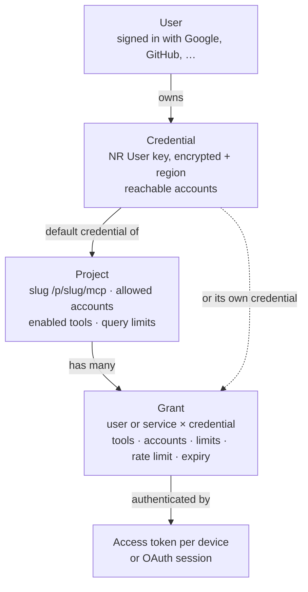
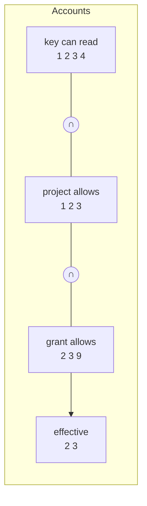

# Access model: credentials, projects and grants

This applies to the remote modes (self-hosted `serve`, Docker, Cloudflare). In stdio mode the process serves one
project with one key from your config, and none of this is needed.

Design record: [ADR-0008](../adr/0008-access-model.md). Code: `packages/auth/src/access`.

## The pieces



| Piece | What it is |
|---|---|
| **Credential** | A New Relic User key (`NRAK-…`) and its region. Stored encrypted ([secrets](secrets.md)). When it is added, New Relic is asked who it belongs to and which accounts it can read (`actor.user`, `actor.accounts`); a key New Relic refuses is not stored. |
| **Project** | One MCP endpoint, `/p/{slug}/mcp`. It sets the **upper limit**: allowed accounts, a default account, the tools it enables (all read-only tools when unset), query limits, and optionally a default credential. |
| **Grant** | Lets one user (or a named service) use one project. It can only **narrow** the project: a tool allowlist, an account allowlist, tighter query limits, a rate limit, an expiry. It may name its own credential, otherwise it uses the project's default. |
| **Access token / OAuth session** | How one device or app proves it holds a grant. Several per grant; revoke one when you lose a device. A token works only on its own project's URL. |

## What a request may do

Every request is resolved afresh (cached for at most a minute):

```
tools    = project tools ∩ grant tools                          (minus run_nrql / get_query_result when raw NRQL is off;
                                                                 write tools only when both name them, see below)
accounts = accounts the key can read ∩ project accounts ∩ grant accounts
limits   = project limits, tightened by the grant               (smaller number wins; raw NRQL needs both;
                                                                 event-type allow lists intersect, deny lists add up)
key      = grant credential, else the project's default credential
```



- A grant can never get more than the project allows. Asking for more is accepted when the grant is created, with a
  warning, and simply has no effect.
- Tools a connection may not use are **not listed** to the client at all, and calls to them are refused anyway.
- The default account is the project's default when it is still allowed, else the first allowed account in the
  project's order.
- **Write tools** (opt-in, server flag `RB_WRITE_TOOLS=on`) are never implied by "all tools": the project and the grant
  must both name them, only owners can do that, and the key must be shared or the grant user's own. Details:
  [write tools](security-basics.md#write-tools-opt-in).

### Fail closed

Access is denied when anything is missing or doubtful, never widened:

| Situation | Result |
|---|---|
| Unknown or disabled project | denied |
| Grant revoked, expired, deleted, or belonging to another project | denied |
| Grant user deleted or disabled | denied |
| No credential (grant has none and the project has no default) | denied |
| Credential revoked, refused by New Relic (`invalid`), or never validated | denied |
| The credential's owner is disabled or deleted (also for grants using it as the team default) | denied |
| Grant names another user's personal key | denied (see below) |
| Stored limits or lists that don't validate | denied |
| No tool or no account left after the intersection | denied |

The reason is written to the logs and the audit log. The client only gets a generic 401/403, so it can't probe which
projects or grants exist.

## Keeping keys current

Keys can be revoked in New Relic, or lose access to an account. Run `relic-bridge credential revalidate` regularly
(a daily cron job is enough; see [self-hosting](self-hosting.md#re-checking-stored-new-relic-keys)): a refused key is
marked `invalid` and every grant using it stops working; for a valid key the list of readable accounts is refreshed.
Network errors and rate limits leave the stored status alone.

## Which credential may a grant use?

A grant may use:

1. the project's default credential,
2. a shared credential (one without an owner, added by an admin), or
3. a credential owned by the grant's own user.

A grant naming **someone else's** personal key is refused when it is created and denied at request time, so a
teammate can never run on your New Relic identity by mistake. To share a key on purpose, make it the project's default
or add it without an owner.

## Example: personal setup (several devices, two accounts)

One user, two keys (say a US and an EU organisation), two projects, one grant each, one token per device:

```
credential "us-key"  (US, reaches 1111 2222)      credential "eu-key"  (EU, reaches 3333)
project "prod-us" → accounts 1111 2222, default 1111, default credential us-key
project "prod-eu" → accounts 3333,                 default credential eu-key
grant  you × prod-us        grant  you × prod-eu
tokens: laptop, desktop, work PC (phone later, via OAuth)  — per grant, revoked one by one
```

Every device sees every read-only tool on both projects. Losing a device means revoking one token.

With the [management CLI](../reference/cli.md) (add `--remote https://mcp.example.com` to run it from another machine):

```bash
relic-bridge user add --email you@example.com --role owner              # prints the user id (usr_…)
relic-bridge credential add --label us-key --region US --owner usr_…    # prompts for the key; prints cred_…
relic-bridge credential add --label eu-key --region EU --owner usr_…
relic-bridge project add --slug prod-us --accounts 1111,2222 --default-account 1111 --default-credential <us cred id>
relic-bridge project add --slug prod-eu --default-account 3333 --default-credential <eu cred id>
relic-bridge grant create --project prod-us --user usr_… --label you
relic-bridge grant create --project prod-eu --user usr_… --label you
relic-bridge token create --grant <grant id> --label macbook --url https://mcp.example.com   # one per device and grant
```

(The tokens of the phone in the diagram need OAuth, Phase 5; today use the computers.) Step by step for several devices
on one project: [multi-device guide](multi-device.md). `init` does the first credential, project, grant and token in
one go when you don't need users.

## Example: team, bring your own key (recommended)

Each member adds their **own** New Relic key and gets a grant that points at it:

```
project "checkout" → accounts 1111 2222, tools: all read-only, maxWindowDays 30
grant  alice × checkout, credential alice-key
grant  bob   × checkout, credential bob-key, tools: run_nrql search_entities, accounts: 2222, maxWindowDays 7
```

```bash
relic-bridge user add --email alice@example.com --role member                       # usr_…
relic-bridge credential add --label alice-key --region US --owner usr_alice        # Alice's own key, from a prompt
relic-bridge project add --slug checkout --default-account 1111 --accounts 1111,2222
relic-bridge grant create --project checkout --user usr_alice --credential cred_alice
relic-bridge grant create --project checkout --user usr_bob --credential cred_bob --tools run_nrql,search_entities --accounts 2222
relic-bridge token create --grant <alice grant> --label alice-laptop --url https://mcp.example.com
```

The CLI has no option for `maxWindowDays` (project and grant limits); set limits through the
[admin API](../reference/admin-api.md). Each member can also run this against the server with `--remote` only if you give
them the admin token, which you should not: create their tokens yourself and hand them over.

Why this is the recommended pattern:

- New Relic's own permissions apply: Bob can never read more through relic-bridge than his key allows in New Relic
  (`accounts` above is always cut down to what the key can read).
- Each person has their own New Relic concurrency budget (about 25 concurrent NerdGraph requests per user), so one
  busy agent doesn't slow everyone else down ([research §2](../RESEARCH.md)).
- Audit entries and New Relic's own logs show who ran what.
- Revoking a member is one grant (or their key) away.

## Example: team with a shared key

An admin adds one key without an owner and makes it the project's default; members' grants leave the credential
unset. Simpler, but everyone shares that key's New Relic permissions and concurrency, and New Relic sees one identity.
Use grants to narrow tools and accounts per person.

## Devices and access tokens

Every device (laptop, desktop, work PC) gets its **own** token, bound to one grant and so to one project. Losing a
device means revoking that one token (`relic-bridge token revoke`); the others keep working. The phone and claude.ai
need OAuth (Phase 5). Step by step: [multi-device guide](multi-device.md).

A token looks like `rb_live_<43 random characters>_<6-character checksum>`:

- **256 bits** of randomness from the platform's CSPRNG (WebCrypto).
- The `rb_` prefix lets secret scanners (our gitleaks rule) and relic-bridge's own log
  redaction spot a leaked token.
- The checksum lets the server reject a typo or a made-up string **without touching the database**.
- Only a SHA-256 hash and the first 12 characters (`rb_live_Ab3d`, for telling tokens apart in lists) are stored. The
  token itself is shown **once**, when it is created, and can't be recovered: lose it and create a new one.
- **Expiry**: 90 days by default; any other lifetime, or `never` (allowed, with a warning; prefer rotating). A token
  never outlives its grant in practice: the grant's own expiry and revocation are checked on every request too.
- **Revocation** is immediate in storage; `serve` caches resolved access for `RB_ACCESS_CACHE_TTL` seconds (default
  30, at most 60, `0` disables), so a revocation takes effect within that time.
- **Last used** is recorded at most once every 5 minutes per token, so a busy client doesn't turn every call into a
  database write.
- Send it as `Authorization: Bearer rb_live_…`. A token for another project's URL is refused like a wrong token.

Treat a token like a password: keep it in your MCP client's secret store or an environment variable, never in a
committed config file.

## Managing it

Everything above is managed with the `relic-bridge` management commands (`user`, `credential`, `project`, `grant`,
`token`; [CLI reference](../reference/cli.md)) or the [admin API](../reference/admin-api.md) they use. The domain
services live in `@relic-bridge/auth` (`createCredential`, `createProject`, `createGrant`, `issueAccessToken`, ...).
