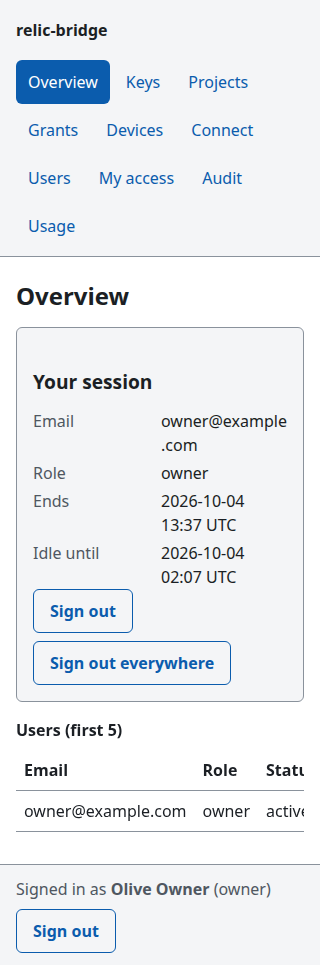
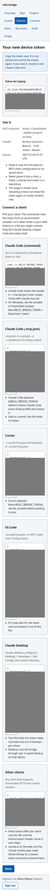
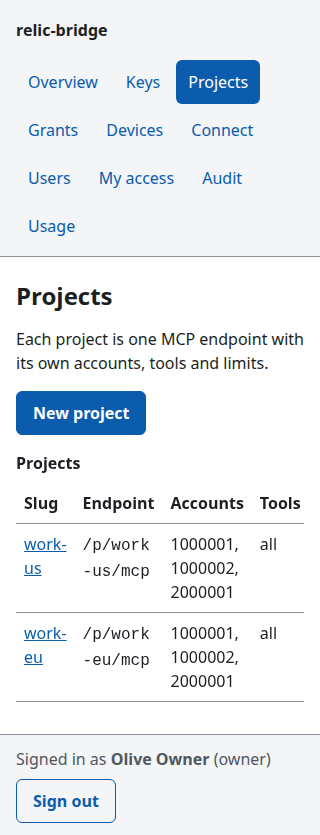

# Admin guide: from a running server to a team on their phones

This is the page to start with once relic-bridge runs on a server (`relic-bridge serve`, Docker or a Cloudflare Worker).
It walks through signing in, deciding who may sign in, the three roles, the first owner, a team where everyone brings
their own New Relic key, and the daily tasks. Everything is done in a browser, on a phone too.

Details live in the other guides; this page links to them:
[identity providers](identity-providers.md) (provider setup) · [admin access](admin-access.md) (sessions, roles, CSRF) ·
[admin panel](admin-panel.md) (every screen, with pictures) · [access model](access-model.md) ·
[multi-device](multi-device.md) · [audit log](audit-log.md).

 

## 1. What you need first

- A running server reachable over `https` (a Worker, or `serve` behind TLS), and its public address as `RB_PUBLIC_URL`.
  For a quick try on your own machine `http://localhost:8787` also works.
- `RB_MASTER_KEY` (encrypts stored New Relic keys) and `RB_ADMIN_TOKEN` (32+ random characters). The admin token is the
  break-glass owner: it is for the CLI and for the one-time first-owner step, not for daily use. See [secrets](secrets.md).
- At least one sign-in provider. **Sign-in, and with it the panel, is off until one is configured.**

## 2. Choose how people sign in

| Provider | Choose it when | Set |
|---|---|---|
| Google | Your people have Google accounts (Workspace or personal). | `RB_GOOGLE_CLIENT_ID`, `RB_GOOGLE_CLIENT_SECRET`, optional `RB_GOOGLE_HOSTED_DOMAIN` |
| GitHub | Your people are developers; you want to admit an organization. | `RB_GITHUB_CLIENT_ID`, `RB_GITHUB_CLIENT_SECRET` |
| Cloudflare Access | Cloudflare Access already guards your hostname. | `RB_CF_ACCESS_TEAM`, `RB_CF_ACCESS_AUD` |
| Any OpenID Connect | Okta, Entra ID, Auth0, Keycloak, Authentik, ... | `RB_OIDC_ISSUER`, `RB_OIDC_CLIENT_ID`, `RB_OIDC_CLIENT_SECRET` |

You can configure several; the sign-in page lists them all. Step-by-step registration at each provider (redirect URI
`<RB_PUBLIC_URL>/auth/callback/<provider>`) is in [identity providers](identity-providers.md#4-providers).


## 3. Who may sign in: the allow-lists

Signing in proves **who someone is**. It never decides **whether they may use relic-bridge**. That decision is yours,
and the default is **no**. A person gets in only through one of three doors:

| Door | How it works | Use it when |
|---|---|---|
| **1. You add the user** | `relic-bridge user add --email ana@example.com` or *Users → Add a user* in the panel. When Ana signs in with a provider that confirms that email, the account is bound to her provider identity. | Small teams. The safest choice: nobody is let in that you did not name. |
| **2. Allow-list + auto-provisioning** | Someone you did not add signs in; if their identity matches an allow-list **and** `RB_LOGIN_AUTO_PROVISION` is `member` or `admin`, a user is created with that role. | Many people at one company. |
| **3. A setup link** | A single-use link that makes whoever signs in through it the `owner`. | Only the first owner (section 4). |

The allow-lists (comma-separated, only used by door 2):

| Setting | Matches | Example |
|---|---|---|
| `RB_LOGIN_ALLOW_EMAILS` | exact addresses | `ana@example.com,bo@example.com` |
| `RB_LOGIN_ALLOW_DOMAINS` | the part after `@`, exactly: `example.com` does **not** match `sub.example.com` | `example.com` |
| `RB_LOGIN_ALLOW_GITHUB_ORGS` | active members of these GitHub organizations (GitHub sign-in only; a pending invitation does not count) | `my-org` |

Read this twice:

- **An allow-list alone admits nobody.** With `RB_LOGIN_AUTO_PROVISION=off` (the default) the allow-lists have no
  effect (no warning is shown, so check this if people are refused). Setting auto-provisioning without any allow-list
  also admits nobody, and the server logs a warning at start.
- **Auto-provisioning never creates an owner.** Choose `member` (recommended) or `admin`. With `admin`, everyone who
  matches the allow-list becomes an administrator on first sign-in; the server warns about it.
- **A domain allow-list trusts that domain's mail system.** Anyone who can receive mail as `anyone@example.com` and gets
  a provider to say that address is verified passes. That is fine for Google Workspace; think twice with a generic OIDC
  provider, which can assert any address. For Google, `RB_GOOGLE_HOSTED_DOMAIN` additionally checks the signed token's
  `hd` claim.
- **Always refused**, whatever the lists say: an email the provider does not mark as verified (GitHub: the primary
  address must be verified), a disabled user, and an email that belongs to a user already bound to a **different**
  provider account. One user signs in with one provider account.
- A user created by hand binds on the first sign-in whose verified email matches; after that the account is found by the
  provider's stable id, not the email, so a changed address does not lock anyone out.

If someone is refused, the browser shows only a generic message with a request id. The audit log (`login.denied`) has the
reason: see the table in [identity providers](identity-providers.md#troubleshooting).

## 4. The first owner

Ask for a setup link with the admin token, open it in your browser and sign in with your provider:

```sh
relic-bridge setup-link --remote https://bridge.example.com --provider google --ttl 30   # admin token from RB_ADMIN_TOKEN
```

Whoever signs in through the link becomes `owner`. It works once, expires after `--ttl` minutes (default 60) and is
printed once on stdout: treat it like a password until used. If a sign-in through it is refused (a disabled user, an
identity conflict), the link is used up; ask for a new one. Other ways to get one (curl, local database) are in
[identity providers](identity-providers.md#3-first-owner-setup-link).

On a Worker, `pnpm cf:setup --sign-in` asks for the public URL and each provider's client id and secret first
([Cloudflare deploy](cloudflare-deploy.md#sign-in-on-the-worker)).

## 5. Roles

| Role | In the panel and API |
|---|---|
| `owner` | Everything, including master-key rotation, setup links, **moving a user to another provider**, managing other owners and **enabling write tools** on projects and grants. The bootstrap `RB_ADMIN_TOKEN` acts as owner. |
| `admin` | Keys, projects, grants, device tokens and users, the audit log with CSV export, usage statistics and the connect page. Cannot create, promote, change or sign out an owner, and cannot act on an owner's personal keys, grants or device tokens (or make an owner's key a project default). |
| `member` | Overview, their own rows in the audit log, and **My access**: their own keys, their grants and device tokens. |

Nobody can change their own role or disable themselves through a session. Changing a role or disabling a user ends all
of that user's sessions at once. Details: [admin access](admin-access.md#roles).

## 6. Set up a team that brings its own keys

Each person uses their own New Relic User key, so New Relic's own permissions and audit trail still apply to them and
nobody shares a key. You (admin or owner) shape the access; members attach their key and create their device tokens.

1. **Create the project once** (*Projects → New project*): choose a default key (a key of yours or a shared one; its
   region is the project's region), the accounts and tools the project may use, and its query limits. The project is
   the ceiling: no grant can exceed it.
2. **Add the people** (*Users → Add a user*) as `member`, or let auto-provisioning do it (section 3). Tell them the
   panel's address (`<RB_PUBLIC_URL>/admin`); no email is sent.
3. **Give each person a grant** (*Grants → New grant*): choose the project and the person, and optionally narrow tools and
   accounts, add a rate limit and an expiry. Leave the key as *Project default* for now.
4. **Each member signs in, opens *My access*** and:
   - *Add a key*: pastes their New Relic User key (checked with New Relic, stored encrypted, never shown again);
   - *Change key* on their grant, to use their own key instead of the project default (tools, accounts and limits stay
     as you set them);
   - *New device token* per device (`laptop`, `phone`): shown once, with connect snippets.
5. If a member's key stops working (New Relic refuses it), their grant stops; yours and everyone else's do not.


Members cannot create grants or widen them; that stays with administrators. The matching API is `/api/admin/v1/me/*`
([admin access](admin-access.md#member-self-service-apiadminv1me)).

### Enabling write tools (owners)

With `RB_WRITE_TOOLS=on` the tool checklists also show the write tools, badged `write` or `destructive`
([what they do](security-basics.md#write-tools-opt-in), [ADR-0015](../adr/0015-opt-in-write-tools.md)). To let one
person use, say, `acknowledge_issue`:

1. As an owner, open the project and tick `acknowledge_issue` (next to "all tools" if you keep the rest: the choice is
   then saved as an explicit list of today's read tools plus the write tool, so read tools added in later versions need
   ticking later).
2. On that person's grant, tick it too. "Every tool the project enables" never includes write tools.
3. The grant must use a shared key or the person's own key; with someone else's personal key (for example your key as
   the project default) write tools stay off for that grant.
4. Their OAuth app must ask for `mcp:write`, and they tick "Also allow changes" on the consent screen. Device tokens
   need nothing more.

Admins see the write tools but get `403` when they try to add one. Once a project or grant names a write tool, an
admin also gets `403` (`write_scope`) for anything that widens where it writes: more allowed accounts, another default
account or default key, any change of limits, re-enabling the project, lifting or raising the grant's quota, a new
token on the grant, or rotating a key such a project or grant uses. Ask an owner (or use the admin token). Admins can
still narrow: remove the write tools, disable the project, take accounts away, lower a quota, revoke or delete.

Every write appears twice in the audit log: a `write.intent` row stored **before** the change is sent (if it cannot be
stored, the write is refused and nothing is sent), then the `Tool call` row with its `write` record. An intent row
without a matching tool call row means the call ended before reporting: check the target in New Relic. Write calls
always check access in storage, so revoking a grant or token stops its next write at once. Turn the server flag off to
remove every write tool at once.

## 7. Using it from a phone

The panel is built for it: it works without JavaScript, holds together down to a 320 px wide screen with no sideways
scrolling, and follows your light or dark setting.

- Open `<RB_PUBLIC_URL>/admin` and sign in with the provider. A link to a panel page from chat or mail works; it asks you
  to sign in and then brings you back to the same page.
- **Lost or retired phone:** *Devices*, find the token (its device name and prefix are listed), *Revoke*. It stops at once.
  Other devices keep working because each has its own token.
- **A new device from the phone:** *Devices → New device token*, copy the token right away (it is shown once), paste it
  into the client. *Connect* shows the snippets for Claude Code, Cursor, VS Code and Claude Desktop.
- Sessions end after **30 minutes without a request** and **12 hours after sign-in**, whatever you do. On a phone you can
  lengthen them with `RB_SESSION_IDLE_MINUTES` (5 to 1440) and `RB_SESSION_MAX_HOURS` (1 to 168); the idle time may not
  exceed the maximum. Shorter is safer, so lengthen only as far as you need.
- The Claude mobile app and claude.ai on the web cannot use device tokens: they need OAuth, which is Phase 5. Until then
  the phone is for **managing** relic-bridge, and for MCP clients that accept a bearer token.



## 8. Sessions, sign-out and CSRF in short

- The cookie is `__Host-rb_session` (`rb_session` on `http://localhost`): `HttpOnly`, `Secure`, `SameSite=Lax`, no
  `Domain`. The database keeps only its hash, so signing out or revoking takes effect on every server instance at once.
- *Sign out* and *Sign out everywhere* are at the bottom of every page. An admin can end all sessions of a user from
  that user's page; their device tokens keep working (disable the user or revoke the grant to stop those).
- Every form carries a CSRF token and is accepted only from the panel's own origin. Cross-site images, scripts, frames and
  `fetch` calls never reach the session. Bearer tokens never open a panel page.
- Sign-in requests are rate limited per client address: default 60 per 5 minutes (`RB_RATE_LIMIT_SIGN_IN` on `serve`).
  On Workers the rule is fixed at the default and counted per isolate (best effort), like the auth-failure throttle,
  unless the shared limiter is on (`RB_SHARED_LIMITER=rules`, [Cloudflare limits](cloudflare-limits.md#shared-limiter-durable-object-optional)).
  Behind a reverse proxy, set `RB_TRUSTED_PROXY_HOPS` or everyone shares one address.

## 9. Everyday tasks

| Task | Where |
|---|---|
| Someone leaves | *Users*, open them, *Disable*: signs them out and stops their grants and personal keys. Delete their keys afterwards if you want them gone. |
| A device is lost | *Devices*, *Revoke*. |
| A key leaked or rotated at New Relic | *Keys*, open it, *Replace the key*; revoke the old one in New Relic. |
| A user wants another provider | Owner: user page, *Move to another provider* (or `relic-bridge user unbind`). Until they sign in again, anyone controlling that email at a configured provider can take the account; check with the person first. |
| Who did what | *Audit*: filter by time, kind, status, user, device; *Download CSV* (up to 5,000 rows). Members see only their own rows. |
| What is used | *Usage*: calls, errors, denied calls and timings per tool, project, grant, device or day, and the quota counters of grants that have one. |
| Cap what one grant may spend | *Grants*, open it, *Usage quota* (see [Quotas](#quotas-per-grant)). |
| Add a device quickly | *Connect*: pick the project, create a token, copy the snippet. |


### Quotas per grant

A grant can carry a **quota** (P7-12): caps per **UTC day** and per **UTC month** on

- **calls**: real New Relic (NerdGraph) calls. One tool call is one to a few calls (the tool reference lists each tool's
  cost). A repeated query answered from the [query cache](query-cache.md) makes no call and costs nothing; retries of
  one call after a New Relic error count once; a request refused before New Relic (not allowed, bad input, over a limit)
  counts nothing.
- **events inspected**: the number of events New Relic reports as inspected by NRQL queries. While a grant has this cap,
  NRQL asks New Relic for its cost statistics (a larger answer from New Relic; the agent still only sees them when it
  asks). The number is known after the query, so the cap is checked *before* each call: once the counter is at or above
  it the next call is refused, and the queries already running can take it somewhat past the cap.

What the agent sees:

- At `warnPercent` of any cap (default 80) every result carries one extra line: *Quota warning: this connection has used
  85% of its daily New Relic call quota (85 of 100); it starts again at 2026-10-07T00:00:00.000Z (UTC).*
- Past a cap the tool fails with **`RB_LIMIT_QUOTA`**: *The daily New Relic call quota for this connection is used up*,
  with the period, which cap, its value and when it starts again. Nothing else is revealed: not the project, other grants,
  their usage or the key. No call reaches New Relic. Everything else the grant can do (the list of tools, prompts) still
  works.

Set it on the grant's page, or with the API (`PUT /api/admin/v1/grants/{id}/quota`, `{"quota": {"day": {"queries": 200,
"inspectedEvents": 50000000}, "month": {"queries": 3000}, "warnPercent": 80}}`; `{"quota": null}` removes it; `POST
/grants` takes `quota` too). It is also in the config export and import (a quota of an existing grant is not changed by an
import, like the rest of the grant). Changing a quota keeps the counters, so lowering a cap below today's use refuses
at once, and it takes effect on the next request on the server that handled the change (other servers: within the
access cache TTL, 30 s by default). Usage is on the **Usage** page (`GET /usage/quotas`).

Where the counters live: in the database (`grant_usage`, one row per grant and period, changed by a single atomic
statement, so concurrent calls from several devices or Worker isolates cannot overshoot a cap), or, on Workers with
`RB_SHARED_LIMITER=on`, in one [Durable Object](cloudflare-limits.md#shared-limiter-durable-object-optional) per grant, which
spares a D1 write on every New Relic call. A grant with a quota costs one counter write per New Relic call (two with
both a day and a month cap). If the counters cannot be reached the call is **allowed** and a warning is logged: a cost
control should not turn a database or Durable Object outage into an outage of the tool. Quotas apply to grants only; the
stdio server and the pass-through endpoint have none. Denials are audited once per grant, period and cap every 15 minutes
(`quota.denied`, plus the ordinary `tool_call` error rows), and every quota change is an admin audit row
(`grant.quota_set`).

Three soft spots to know about (all deliberate):

- **Counter store down: fail open.** The call goes through and a warning is logged, so a quota can be exceeded during
  an outage.
- **Inspected events: overshoot.** The number is known only after a query finishes, so calls running in parallel when the
  cap is reached can all finish and take the counter past it. The call cap has no overshoot.
- **Cache hits are free, even at the cap.** A grant that has used up its call quota is still served rows that the
  [query cache](query-cache.md) already holds for it: up to 30 seconds for moving windows and 10 minutes for windows that
  ended a while ago (`cache: "bypass"` is refused at the cap like any other call). Those rows come from earlier calls
  that were counted when they ran.

## 10. Settings added in Phase 4

| Variable | Default | Meaning |
|---|---|---|
| `RB_PUBLIC_URL` | unset | Origin browsers use (https, or `http://localhost`). Required for sign-in; with `serve` its host must be in `RB_ALLOWED_HOSTS`. |
| `RB_GOOGLE_CLIENT_ID`, `RB_GOOGLE_CLIENT_SECRET`, `RB_GOOGLE_HOSTED_DOMAIN` | unset | Google. |
| `RB_GITHUB_CLIENT_ID`, `RB_GITHUB_CLIENT_SECRET` | unset | GitHub. The user token is revoked at GitHub right after the lookup. |
| `RB_OIDC_ISSUER`, `RB_OIDC_CLIENT_ID`, `RB_OIDC_CLIENT_SECRET`, `RB_OIDC_NAME`, `RB_OIDC_LABEL`, `RB_OIDC_SCOPES` | unset | Generic OpenID Connect. |
| `RB_CF_ACCESS_TEAM`, `RB_CF_ACCESS_AUD` | unset | Cloudflare Access. |
| `RB_GOOGLE_CLIENT_SECRET_FILE`, `RB_GITHUB_CLIENT_SECRET_FILE`, `RB_OIDC_CLIENT_SECRET_FILE` | unset | `serve` only: read the secret from a file (mode `0600`, only the secret). Setting both forms is an error. |
| `RB_LOGIN_ALLOW_EMAILS`, `RB_LOGIN_ALLOW_DOMAINS`, `RB_LOGIN_ALLOW_GITHUB_ORGS` | unset | Allow-lists (section 3). |
| `RB_LOGIN_AUTO_PROVISION` | `off` | `off`, `member` or `admin`. Never `owner`. |
| `RB_SESSION_IDLE_MINUTES` | `30` | 5 to 1440. |
| `RB_SESSION_MAX_HOURS` | `12` | 1 to 168. |
| `RB_RATE_LIMIT_SIGN_IN` | `60/300` | Sign-in requests per client address (`serve` only; fixed on Workers, per isolate unless `RB_SHARED_LIMITER` is on). |

Variables go in the environment for `serve` (also Docker and compose). On a Worker, ids and public settings are
variables and client secrets are Worker secrets; `pnpm cf:setup --sign-in` sets them (it asks for the public URL, each
provider's client id and secret, and takes the same answers from `RB_PUBLIC_URL`, `RB_GOOGLE_CLIENT_ID`,
`RB_GOOGLE_CLIENT_SECRET`, ... in your shell when there is no terminal). Cloudflare Access variables are set in the
dashboard. A full list for `serve` is in [self-hosting](self-hosting.md#run-the-server) and `relic-bridge --help`.

## 11. For contributors: checking the panel

Two checks sit outside `pnpm test` because they need a browser or Docker:

- `pnpm test:e2e`: Playwright (Chromium) drives the real built server with a mock identity provider and a mock NerdGraph
  through the whole panel; `pnpm e2e:screenshots` rewrites the pictures in `docs/guide/images/`.
- `pnpm scan:zap`: an OWASP ZAP baseline scan of the sign-in page, the panel (signed in) and the API; Medium or High
  alerts not listed in `.zap/rules.tsv` fail it. Run it only against its own throwaway instance.

Both are described in [CONTRIBUTING](../../CONTRIBUTING.md) and [`docs/dev/admin-ui.md`](../dev/admin-ui.md).
