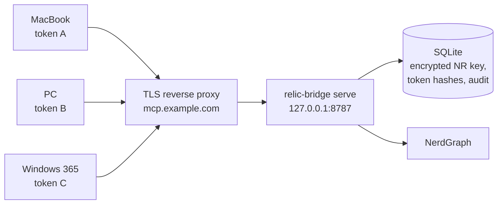

# Multi-device setup: one server, one token per device

Goal: run **one** relic-bridge server and connect several machines to it (here a MacBook, a PC and a Windows 365
desktop, all with Claude Code), each with its **own** token, so that a lost or retired device is cut off by revoking
one token while the others keep working. The New Relic key lives only on the server, encrypted.



> **On Cloudflare instead of your own server?** The same flow works against a Worker (no VPS, no TLS proxy): see
> [Deploy to Cloudflare, connect your devices](cloudflare-deploy.md#connect-your-devices).

> **Phone and claude.ai (web):** they can't send a static bearer token, so they connect with OAuth (`RB_OAUTH=on`,
> sign-in required): see [Use relic-bridge from your phone and claude.ai](oauth-phone.md). The split: laptops and
> desktops use one device token each (this guide); the phone uses OAuth, revocable on its own under **My access**.
> The OAuth path is implemented and tested with SDK clients but not yet run with the real Claude apps.

What you need: a machine that is always on and reachable from your devices (a VPS, a home server), a DNS name for it
(`mcp.example.com` below), Node.js 24.11 or later or Docker, and a New Relic **User** API key
([quickstart](quickstart-local.md) explains where to find the key, its region and your account id).

## TLS is required

Device tokens and New Relic data cross the network on every request. **Serve MCP over https for every address that is
not loopback.** The server itself speaks plain HTTP and binds `127.0.0.1` by default; terminate TLS in a reverse proxy
(Caddy, nginx, a Cloudflare Tunnel) and let only the proxy reach the server. A token sent over plain HTTP can be read
by anyone on the path, and a leaked token is a leaked New Relic read connection. This holds on a home network too.

## 1. Set up the server

Pick Docker or Node; both end with a server that only a TLS proxy can reach.

### Option A: Docker with Caddy (recommended)

Follow the commented steps at the top of [`deploy/docker-compose.example.yml`](../../deploy/docker-compose.example.yml):
create `master.key` (owned by uid `65532`, mode `0400`), put `MCP_HOSTNAME=mcp.example.com` in `.env`, then
`docker compose -f docker-compose.example.yml up -d`. Caddy gets the certificate by itself (ports 80 and 443 must be
reachable and the name must resolve to the server). Details and the key-file rules: [self-hosting, Docker](self-hosting.md#docker).

The database commands below run inside the container. Add an alias so they read like the rest of this guide:

```bash
alias relic-bridge='docker compose -f docker-compose.example.yml exec relic-bridge /nodejs/bin/node /app/dist/index.mjs'
```

(The image has no shell. `exec` runs in the running container, which already has `RB_MASTER_KEY_FILE` and
`RB_DATA_DIR=/data`. `compose exec` gives you a terminal, so the hidden key prompt works; to pipe the key on stdin use `exec -T`. Or use
`--remote` from your laptop as in [section 4](#4-manage-from-your-laptop-optional).)

The management commands need an existing database, and `serve` creates it on its first start, so `docker compose up -d`
comes first. Then add your New Relic key, a project and a grant for your devices:

```bash
relic-bridge credential add --label main --region US      # hidden prompt; prints the credential id (cred_…)
relic-bridge project add --slug prod --default-account 1234567 --default-credential cred_…
relic-bridge grant create --project prod --label prod-devices    # prints the grant id (grt_…)
```

Replace `1234567` with the account id you query most (the credential's reachable accounts are printed when it is added;
the project allows the default account unless you pass `--accounts 1,2`). Skip to [section 2](#2-create-one-token-per-device).

### Option B: Node and a service

```bash
# 1. Master key and database, then the first New Relic key, project and device token.
relic-bridge init --master-key-file /etc/relic-bridge/master.key \
  --label main --region US --slug prod --default-account 1234567 \
  --device macbook --url https://mcp.example.com
```

`init` asks for the New Relic key on a hidden prompt (or reads it from stdin, `--key-file` or `--key-env`), validates it
against New Relic, stores it encrypted, creates the project `prod` and a grant for your devices (`prod-devices`), and
prints the **first device token once**, with the configuration for each client. The key file must live outside the data
directory so a backup of the data never contains it (the default is `~/.config/relic-bridge/master.key`; `init`
refuses a path next to the database), and back it up separately ([secrets](secrets.md)). Replace `1234567` with the id of your default account.

Then run it as a service. A systemd unit (Linux; adapt paths; not run by the maintainers' CI):

```ini
# /etc/systemd/system/relic-bridge.service
[Unit]
Description=relic-bridge MCP server
After=network-online.target
Wants=network-online.target

[Service]
User=relic-bridge
Environment=RB_DATA_DIR=/var/lib/relic-bridge
Environment=RB_MASTER_KEY_FILE=/etc/relic-bridge/master.key
Environment=RB_ALLOWED_HOSTS=mcp.example.com
Environment=RB_TRUSTED_PROXY_HOPS=1
Environment=RB_HSTS=true
ExecStart=/usr/bin/node /opt/relic-bridge/apps/cli/dist/index.mjs serve
Restart=on-failure
NoNewPrivileges=true
ProtectSystem=strict
ReadWritePaths=/var/lib/relic-bridge
PrivateTmp=true

[Install]
WantedBy=multi-user.target
```

The `relic-bridge` user must own `master.key` (mode `0400` or `0600`; the server refuses a file others can read) and
the data directory, and the `init` command above has to run as that user so the database is created with the right
owner (`sudo -u relic-bridge env RB_DATA_DIR=/var/lib/relic-bridge ... relic-bridge init ...`). Keep the default bind
`127.0.0.1` and put Caddy or nginx in front, proxying `https://mcp.example.com` to `127.0.0.1:8787` with response
buffering off (Streamable HTTP can answer with an event stream; the [Caddyfile](../../deploy/Caddyfile) shows the
settings). `RB_TRUSTED_PROXY_HOPS=1` makes the server read the client address from the proxy's `X-Forwarded-For`.
`RB_HSTS=true` sends `Strict-Transport-Security` although the server sees plain http from the proxy (an https
`RB_PUBLIC_URL`, needed for sign-in, does that too; `RB_HSTS=false` turns it off).
Every setting: [self-hosting](self-hosting.md#run-the-server).

### Check the server

```bash
curl https://mcp.example.com/health     # {"status":"ok"}
```

A request for any other `Host` than the names in `RB_ALLOWED_HOSTS` is refused, so a `403 forbidden_host` here means
the name in the URL is not listed.

## 2. Create one token per device

A **grant** says who may use which project (here: your devices, project `prod`); a **token** is one device's proof of
that grant. Look up the grant id (Option B's `init` already issued the first token, for the MacBook; with Docker
create all three):

```bash
relic-bridge grant list                     # note the ID of the grant on project prod
relic-bridge token create --grant grt_… --label macbook --url https://mcp.example.com --client claude-code   # Docker only
relic-bridge token create --grant grt_… --label pc   --url https://mcp.example.com --client claude-code
relic-bridge token create --grant grt_… --label w365 --url https://mcp.example.com --client claude-code
```

Each command prints the token on stdout, **once**, and the ready-to-paste configuration on stderr. Name tokens after
the device (`macbook`, `pc`, `w365`); the label is what you will recognise in `token list` and the audit log.

- Tokens expire after **90 days**. `--ttl-days <n>` sets another lifetime; `--never` is allowed but not recommended
  ([access tokens](access-model.md#devices-and-access-tokens)).
- Never paste a token into chat, email or a repository. Send it to the device through a password manager.
- `--client all` prints the snippets for Claude Code, Claude Desktop, Cursor and VS Code; `--no-config` prints only
  the token.

To start with more than one New Relic account or project (for example US and EU), see the
[access model](access-model.md#example-personal-setup-several-devices-two-accounts).

## 3. Connect each device

On every device, run the `claude mcp add` line the CLI printed. It has this shape (placeholder values):

```bash
claude mcp add --transport http --scope user relic-bridge-prod https://mcp.example.com/p/prod/mcp \
  --header "Authorization: Bearer rb_live_<token for this device>"
```

`--scope user` makes the server available in every project on that machine (the default, `local`, is one project
only). Claude Code stores the header in `~/.claude.json` in plain text (a file in your home directory); on shared machines prefer the next
variant. Don't use `--scope project`: it writes `.mcp.json` into the repository, where the token would be committed.

**Keep the token out of the file.** Claude Code expands `${VAR}` in the `headers` of an MCP configuration, so the file
can hold a reference and the token can come from the environment:

```json
{
  "mcpServers": {
    "relic-bridge-prod": {
      "type": "http",
      "url": "https://mcp.example.com/p/prod/mcp",
      "headers": { "Authorization": "Bearer ${RELIC_BRIDGE_TOKEN}" }
    }
  }
}
```

Define `RELIC_BRIDGE_TOKEN` in the environment Claude Code is started from: your shell profile on the MacBook and the
PC, and on Windows a user environment variable (*Settings > System > About > Advanced system settings > Environment
Variables*, or `[Environment]::SetEnvironmentVariable('RELIC_BRIDGE_TOKEN', '<token>', 'User')` in PowerShell, then
restart the terminal). Restart Claude Code after changing it. An unset variable stays unexpanded and the server
answers `401`.

On each device, check it:

```bash
claude mcp list          # relic-bridge-prod ... connected
```

Inside a session, `/mcp` shows the server, and asking "run whoami" answers with the project's account and limits. Other
clients: [client setup, remote servers](clients.md#remote-servers-self-hosted-http).

Windows 365 and any other machine behind a corporate proxy or firewall need outbound https to `mcp.example.com`; if your
organisation inspects TLS, the device must trust that certificate authority.

## 4. Manage from your laptop (optional)

You can run the management commands from any device, against the server, without the master key or the database:
enable the admin API on the server with `RB_ADMIN_TOKEN` (or `RB_ADMIN_TOKEN_FILE`, for Docker the file must be owned
by uid `65532`, mode `0400`) and give the same value to the CLI:

```bash
relic-bridge admin-token generate        # prints a random token once; set it on the server and restart it
export RB_ADMIN_TOKEN=…                  # on your laptop, from your password manager (not on the command line)
relic-bridge token list --remote https://mcp.example.com
```

The admin token can create tokens and read the audit log; treat it more strictly than a device token, and don't put it
on the devices that only need MCP. Remote changes take effect at once on the server. Details: [admin API](self-hosting.md#admin-api).

## 5. A device is lost or retired: revoke its token

```bash
relic-bridge token list                          # find the device by its label and the rb_live_… prefix
relic-bridge token revoke tok_…                  # the lost device's token only
```

- With `--remote` the revocation applies **immediately**. Locally, a running server notices within
  `RB_ACCESS_CACHE_TTL` seconds (default 30, at most 60).
- The other devices are unaffected. The revoked device now gets `401` and cannot ask the server for anything.
- Check what the device did: `relic-bridge audit tail --token-id tok_… --limit 50` ([audit log](audit-log.md)).
- **Revoking a token does not change the New Relic key.** The device never had it: the key stays on the server. If the
  server or its database may also have been exposed, rotate the master key and the New Relic key as described in
  [secrets](secrets.md#rotate-the-key).
- A token that appears in a repository or a chat: revoke it, then create a new one for that device.

## 6. Renewing and day-to-day

- **Renewal**: before a token's expiry (`token list` shows it), create a new token with the same label (suffix it, for
  example `macbook-2`), update the device, then revoke the old one.
- **Last used** in `token list` tells you which devices are still active (it is refreshed at most every 5 minutes).
- **Backups**: `relic-bridge db backup <file>` while the server runs; keep the master key elsewhere
  ([self-hosting](self-hosting.md#back-it-up)).
- **Upgrade**: back up, update the code or the image tag, restart. Migrations run on start and are forward-only.
- **Check stored keys** from cron: `relic-bridge credential revalidate` ([self-hosting](self-hosting.md#re-checking-stored-new-relic-keys)).
- **Limit what a device can do**: a grant can narrow tools, accounts and query limits, and (through the admin API) carry its own rate limit.
  Give a less-trusted device its own grant (`relic-bridge grant create --project prod --label contractor --tools
  whoami,run_nrql --expires-in-days 30`) and a token for that grant ([access model](access-model.md)).

## Troubleshooting

| Symptom | Likely cause |
|---|---|
| `claude mcp list` shows the server as failed, `401` in the server log with `"deny":"malformed"` | The header is not `Bearer rb_live_…`, the token was truncated, or `${RELIC_BRIDGE_TOKEN}` was not set when Claude Code started. |
| `401` with `"deny":"revoked"` or `"expired"` | Revoked or past its expiry: create a new token. |
| `401`, token is fine | The token belongs to another project's URL, or the grant's credential is invalid (`relic-bridge credential list` shows `invalid`; replace the key). |
| `403 forbidden_host` | The hostname is not in `RB_ALLOWED_HOSTS`. |
| `429` | Rate limit, or too many failed authentications from this address; behind a proxy, set `RB_TRUSTED_PROXY_HOPS`. |
| Certificate errors | The proxy has no valid certificate for that name yet. Check the DNS record and that ports 80/443 reach Caddy. |

More: [troubleshooting](troubleshooting.md#hosted-self-hosted-server).
