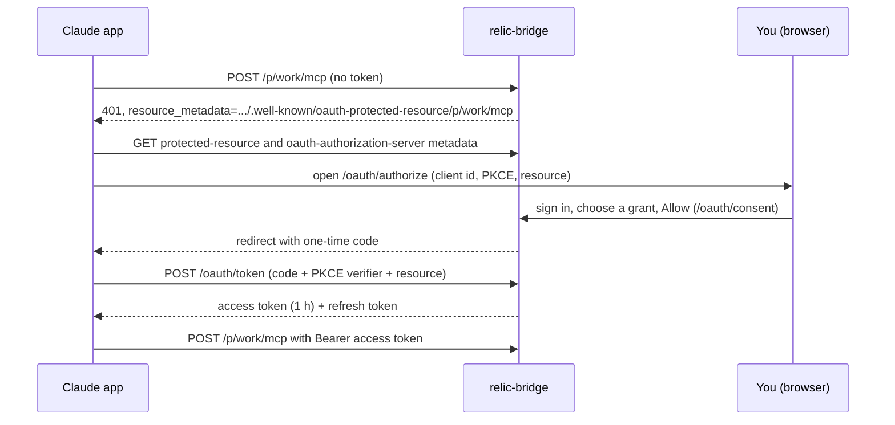

# How OAuth works in relic-bridge

A short explainer for operators. Setup is in [Use relic-bridge from your phone and claude.ai](oauth-phone.md), settings
in the [OAuth guide](oauth.md), code in [docs/dev/oauth.md](../dev/oauth.md) and
[ADR-0009](../adr/0009-authentication.md).

## The pieces

- **One origin, one issuer.** The issuer is `RB_PUBLIC_URL`, never the request's `Host`. Each project is its own
  protected resource, `{issuer}/p/{slug}/mcp`, and a token is bound to exactly one of them (RFC 8707). A token for
  `work` is refused on `eu`.
- **Discovery.** The `401` points to Protected Resource Metadata (RFC 9728) and then Authorization Server Metadata
  (RFC 8414). The answers depend only on the path, so unknown, disabled and refused projects look the same.
- **Who the app is.** Preferred: a **client metadata document** (CIMD): the client id is an https URL (claude.ai,
  Claude Code) that relic-bridge fetches through a guard against private addresses and validates. Fallback: **dynamic
  client registration** (`/oauth/register`), hardened and rate limited, shown on the consent page as **not verified**.
- **Who you are, what you give.** The consent page requires your sign-in session and CSRF token. You choose one of
  **your own grants** on that project; the token can do at most what the grant allows, and never outlives it. The
  New Relic key stays on the server; the app never sees it.
- **Tokens.** Short access tokens, rotating refresh tokens (one use each, with a short reuse window for concurrent
  renewals), PKCE S256, single-use codes. Every renewal re-checks the grant, user, project and key.
- **Per-device revocation.** Each approved app is its own record: **Disconnect** one device, **Remove** an app for all
  users, or revoke the grant. Device tokens for laptops are separate and revoked on the Devices page.
- **Storage.** Provider state lives in the same SQLite or D1 database (ADR-0011); no extra service.

What OAuth does not change: tools are read-only, grants and query limits still apply, and every approval, refusal and
disconnect is in the [audit log](audit-log.md).

Compatibility with specific clients: [client compatibility](../reference/client-compatibility.md).
