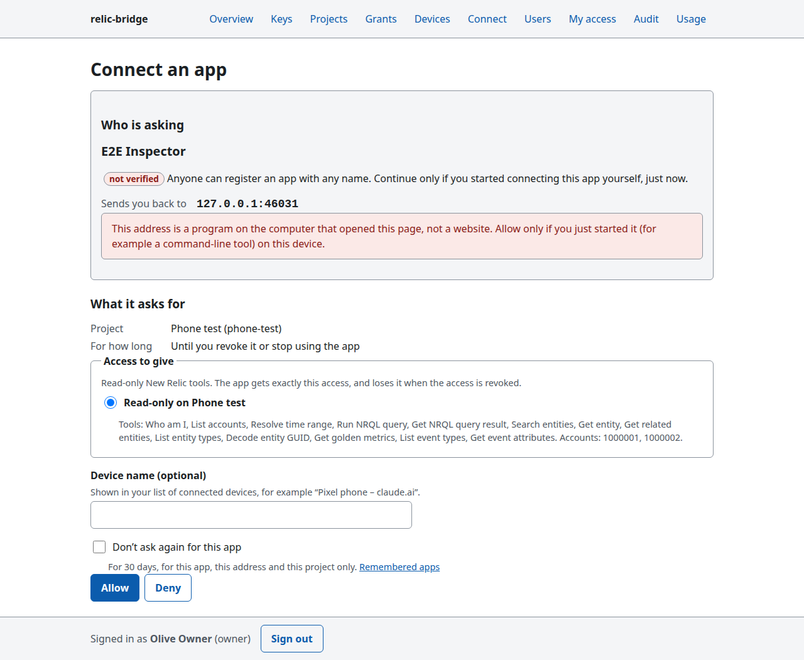
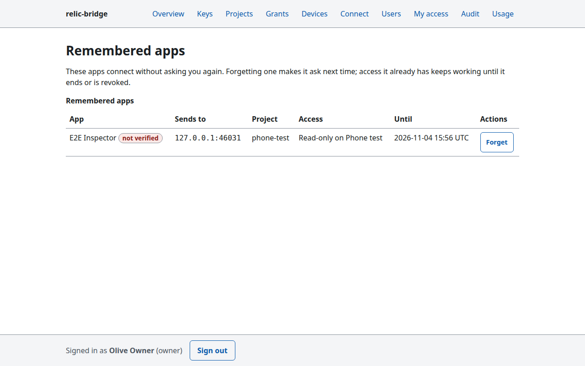

# OAuth: connect claude.ai, your phone and other apps

MCP clients that can't send a fixed header — claude.ai custom connectors (web and the Claude mobile app), Claude
Desktop connectors, Claude Code's `/mcp` login, MCP inspectors — connect with OAuth instead of a device token. The app
opens a page on your relic-bridge server, you sign in, choose which of your accesses the app gets, and approve. The app
then holds a token for that one project only.

Status: sign-in and consent (P5-04), token lifetimes, refresh-token rotation and the list of connected apps with
**Disconnect** (P5-05).

## Turn it on

OAuth needs [sign-in](identity-providers.md) (`RB_PUBLIC_URL` and at least one provider): people approve apps as
themselves.

| Variable | Default | Meaning |
|---|---|---|
| `RB_OAUTH` | `off` | `on` serves `/oauth/*`, the consent page and OAuth tokens on `/p/<project>/mcp`. |
| `RB_OAUTH_DCR` | `on` | Dynamic client registration (`/oauth/register`). Clients with a metadata document (claude.ai, Claude Code) don't need it. |
| `RB_OAUTH_DCR_LIMIT` | `30` | Dynamic registrations per hour for the whole server, or `off`. |
| `RB_OAUTH_DCR_REDIRECT_HOSTS` | any | Comma-separated https hosts dynamically registered clients may send codes to (for example `claude.ai`). Loopback addresses are always allowed. |
| `RB_OAUTH_ACCESS_TTL` | `1h` | How long one access token lives (60 s to 24 h; seconds, or `90m`, `12h`). Apps renew it on their own. |
| `RB_OAUTH_REFRESH_TTL` | `30d` | How long an approval lasts in total (1 h to 365 days). Renewing does not extend it: after it the app asks you again. |

- **Node** (`relic-bridge serve`): set the variables and restart. Metadata documents (claude.ai's way of identifying
  itself) are fetched through a guard that refuses private and loopback addresses.
- **Cloudflare Workers**: add the variables in the dashboard (Settings → Variables) or `wrangler.jsonc`. Metadata
  documents need the `global_fetch_strictly_public` compatibility flag (on in the shipped `wrangler.jsonc`); without it
  the Worker logs a warning and claude.ai falls back to dynamic registration.

Use the public URL (`RB_PUBLIC_URL`) in the app, e.g. `https://bridge.example.com/p/work/mcp`. A `*.workers.dev`
address that differs from `RB_PUBLIC_URL` is refused by careful clients.

## What you see

1. The app sends you to `/oauth/authorize`. Not signed in? You go through sign-in first and come back.
2. The consent page:

   

   - **Who is asking.** An app identified by a metadata document shows the website that vouches for it (for claude.ai
     and Claude Code: `claude.ai`). A dynamically registered app is marked **not verified**: anyone can register any
     name, so continue only if you started connecting it yourself, just now.
   - **Sends you back to.** Where the approval goes. For claude.ai it is `claude.ai`. A red note warns when it is a
     program on your own computer (`localhost`, `127.0.0.1`), as for Claude Code: allow only if you just started it.
   - **Project** comes from the address the app was given; **access to give** lists your own grants on that project,
     with their tools and New Relic accounts. You can't give an app more than your grant allows, nor someone else's
     grant. No grant? The page says so and offers Deny only.
   - **Device name** (optional) labels this connection in your device list.
   - **Don't ask again for this app** (off by default) remembers the approval for 30 days, for this app, this
     address and this project only.
3. **Allow** sends the app back with a one-time code; **Deny** sends it back with `access_denied`.

On a phone the same page fits the screen (no zooming).

## Connected apps

**My access** (`/admin/me`) lists the apps you approved under **Apps connected with OAuth**: the app (with the website
that vouches for it, or **not verified**), the device name you typed, the project and grant, when you connected it and
when it will ask again. **Disconnect…** (after a confirmation page) ends everything that app holds at once — its current
access token and its refresh token — and forgets "don't ask again" for it on that project, so it has to ask you next
time. Administrators see the same list on each user's page (**Users** → a user) and can disconnect a member's or an
admin's app; only owners can disconnect an owner's.

Apps are also disconnected automatically when:

- the grant they were approved with is revoked or deleted, the user is disabled, or the project is deleted;
- the grant, the user or the project stops being usable when the app next renews its token (expired grant, disabled
  project, unusable New Relic key): the renewal is refused and the app has to be approved again;
- a **refresh token is used twice** (see below).

### Lifetimes and renewal

An app gets a short-lived access token (1 hour by default, never longer than the grant it was approved with) and a
refresh token to renew it. Each refresh token works **once**: renewing returns a new pair and the old refresh token is
dead. If an old refresh token is ever presented again — a copy stolen from the app, or two copies of the app renewing
at the same moment — relic-bridge assumes theft and disconnects the app entirely (audit `oauth.token.reuse`); approve
it again to continue. Renewals never push the end of the approval back: after `RB_OAUTH_REFRESH_TTL` (30 days by
default) the app asks you again.

Apps can also give their tokens back (RFC 7009 revocation, as when you sign out in the app): giving back a refresh token
disconnects the app.

A disconnected app's tokens stop at once on the server that handled the disconnect; other processes (other Worker
isolates) may accept an already issued access token for up to `RB_ACCESS_CACHE_TTL` (30 s by default) longer, the same
as for device tokens. Renewing is refused everywhere at once.

## Remembered apps

`/oauth/approvals` lists the apps you told not to ask again, with **Forget**. Forgetting makes the app ask next time;
tokens it already has keep working until they expire (use **Disconnect** under [Connected apps](#connected-apps) to
end them now). A remembered approval also ends by
itself when its grant stops working (revoked, expired, key removed): you are asked again.

## Security notes

- The consent page can't be framed (`frame-ancestors 'none'`, `X-Frame-Options: DENY`) and its form needs your
  session's CSRF token from this site. Each step checks the whole request again: the app, its registered redirect
  address, PKCE and the project.
- Codes go only to the redirect address the app registered (or listed in its metadata document), with `state` and the
  issuer (`iss`). Codes are single use.
- Approvals and denials are in the audit log (`oauth.consent.approve`, `oauth.consent.deny`, `oauth.consent.forget`),
  as are disconnects (`oauth_device.revoke`), refused renewals (`oauth.token.refused`) and reused refresh tokens
  (`oauth.token.reuse`). Each row's token id is `oauth_…`, the same for every request of that connected app.
- Developers: [docs/dev/oauth.md](../dev/oauth.md).
